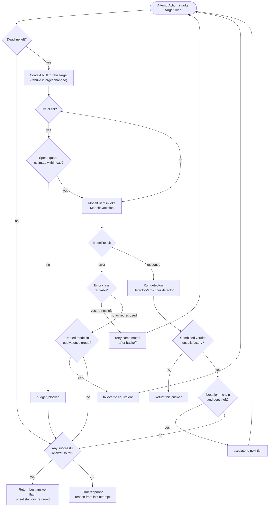

# Attempts: Escalation, Failover, and Retries (Stage 3)

Status: unified attempt model **decided** ([ADR-0013](../adr/0013-unified-attempt-model.md)); which detectors are usable is **open** (U-07, TODO-06); limits **provisional**. Last updated 2026-10-14.
Index: [architecture README](README.md). Components: CMP-01 (executes), CMP-08 (decides), CMP-10 (model clients), CMP-17 (spend guard). Requirements: FR-CASC-*, FR-FAIL-*, FR-ACCT-03/06.

---

## 1. One loop, three reasons to try again

Every model call is an **attempt** with its own ID, linked to the request (FR-REQ-02). An attempt has a **kind**:

| Kind | Trigger | Target | Purpose | Event |
|---|---|---|---|---|
| `primary` | first call | `RoutingDecision.target` | answer | `attempt_started` |
| `retry` | retryable error | the same model | reliability | `retry_scheduled` |
| `failover` | non-retryable provider failure, or retries used up | the next model in the target's **equivalence group** (another provider preferred) | reliability, same tier (FR-FAIL-02) | `failover_triggered` |
| `escalation` | a successful answer judged unsatisfactory | the next model in the **cascade chain** (higher tier) | quality (FR-CASC-01) | `escalation_triggered` |

The **attempt policy** (CMP-08, pure) decides the next action from the `AttemptState`: the routing decision, the chain, every attempt so far with its outcome, time left before the deadline, and budget left. The **pipeline** (CMP-01) executes the action. Retry, failover, and escalation are therefore one mechanism with three policies, not three nested loops. All attempts are charged to the request, including failed and discarded ones (FR-CASC-04, FR-ACCT-03).

---

## 2. Escalation and failover flow

**Question answered:** after each model call, what decides between returning the answer, retrying, failing over, escalating, or giving up?

"Best answer so far" is the most recent successful answer. A configurable rule could rank answers by detector scores instead; that is open.

---

## 3. Errors and failover

Provider adapters normalise every failure into a small error taxonomy ([providers.md §3](providers.md#3-normalised-errors)). The attempt policy maps each class to an action through configuration:

| Error class | Default action |
|---|---|
| `timeout`, `rate_limited`, `unavailable`, `connection` | retry (bounded), then failover |
| `context_overflow` | rebuild context with `trim`, or re-route (context overflow rule) |
| `content_filtered` | return as a refusal; escalation optional by configuration |
| `invalid_request`, `auth` | fail; these are configuration or programming faults, and are not retried |
| `unknown` | one retry, then failover |

- **Bounds** (FR-FAIL-04): maximum retries per model, backoff schedule, per-attempt timeout, and the request deadline. Backoff waits use the `Clock` port, so tests run instantly with a fake clock.
- **Equivalence groups** are declared in the catalogue, never inferred from labels (FR-FAIL-03).
- **Failure behaviour is tested offline** with the fault-injecting client: scripted errors, timeouts, and latency per call (FR-FAIL-06).
- **No SLA is claimed** (FR-FAIL-07, A-15).
- **Health tracking** (circuit breaking, FR-FAIL-05) is future. When added, the attempt policy reads a health snapshot as data, and the eligibility filter skips providers marked down.

---

## 4. Detecting an unsatisfactory response

No single cheap signal is assumed to be enough (A-20). Detectors are pluggable. Each returns a `DetectorVerdict` (detector ID, value, threshold, fired). A configured combination rule (default: any fired detector from an enabled set) produces the decision, and the escalation event records every verdict (FR-CASC-05).

| Signal | Detector | Where the input comes from | Cost and latency | Availability | Notes |
|---|---|---|---|---|---|
| Provider error, empty output | built-in | `ModelResult` | free | live, recorded, fake | Errors are handled as failover, not escalation. |
| Truncation | finish reason = `length` | normalised finish reason | free | live, recorded | Depends on what each provider reports; adapters map it. |
| Refusal | provider flag where exposed (verify per provider), otherwise a multilingual heuristic | `ModelResult` | free | live, recorded | Heuristics are weak, especially for Persian. Precision must be measured. |
| Language mismatch | response language ≠ request language, using the tested detector (FR-FEAT-03) | request features + response | cheap | live, recorded | Legitimate mismatches exist (for example, translation requests). |
| Length anomaly | response length ratio outside a configured band | sizes | free | live, recorded | Weak; useful only in combination. |
| Format failure | output fails a declared format check | request declares a format | cheap | future (NG-09) | Not in the current data. |
| Confidence | log-probabilities or provider confidence | provider-specific | free if returned | **unverified** | Not assumed to exist; verify per provider before use (MP§3.8). |
| Judge score | a `Judge` scores the answer; CMP-02 measures it, the detector thresholds it | `Judge` port | **costly, adds latency** | opt-in | Counts as overhead. Bias must be stated (FR-EVAL-05). |

**Not runtime signals:**
- *Agreement with the logged answer* is an evaluation metric. Using it to decide escalation in replay would be look-ahead (FR-REQ-06).
- *User feedback or regeneration* arrives after the answer. It is a future label source for training and calibrating detectors, not a synchronous detector.

**What can be learned offline now:** only that the mechanism works, using synthetic answers from quality-injecting fakes. Detector precision and recall need recorded or live answers plus labels (TODO-05, TODO-06). That is a Stage 8 cascade experiment.

---

## 5. Limits and cost

- Configuration: cascade chains (ordered tiers), maximum escalation depth, maximum attempts per request, per-attempt timeout, request deadline (FR-CASC-03).
- Escalation adds latency. Reports show end-to-end latency with and without escalated requests (QA-LAT).
- The spend guard checks a **pre-call estimate** before every live attempt (FR-ACCT-06). The estimate uses the input tokens counted for the context plus the configured maximum output tokens. When the cap would be exceeded the attempt is blocked, and the run stops if configured to (ADR-0003). Fake and replay clients are not charged against the cap.
