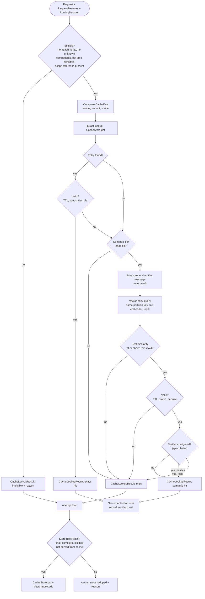

# Caching Flow: Exact and Semantic (Stage 3)

Status: structure **decided** ([ADR-0011](../adr/0011-cache-key-and-lookup-design.md)); validity rules and thresholds **provisional**; the final sharing policy is **open** (Q-16). Last updated 2026-10-14.
Index: [architecture README](README.md). Components: CMP-06 (cache policy), CMP-11 (stores), CMP-13 (embedder). Requirements: FR-XCACHE-*, FR-SCACHE-*, [ADR-0007](../adr/0007-cache-sharing-scope.md).

The sample EDA *informs* this design without fixing any value in it ([ADR-0008](../adr/0008-sample-eda-is-exploratory.md)). Its signal: repeated requests were common, but repeats usually differed in instructions, model, retrieved context, or history (F-6, F-7). So a key that uses the request text alone would produce unsafe hits.

---

## 1. Cache key composition

A key is a keyed fingerprint ([ADR-0015](../adr/0015-keyed-content-fingerprints.md)) over an ordered list of components. Each component is a fingerprint, `absent`, or `unknown`.

| # | Component | Default for serving | How it is fingerprinted | Why it is in the key |
|---|---|---|---|---|
| 1 | Key schema version | always | literal | Changing the composition invalidates old entries by construction. |
| 2 | Normalised current message | always | fingerprint after the configured normalisation (literal / whitespace / NFKC + casefold + whitespace, FR-XCACHE-03) | The request itself. |
| 3 | Instructions | yes | fingerprint of the normalised instruction text | The same question under different instructions can need a different answer (F-7). |
| 4 | History | yes (full) | fingerprint of the full history, or of the last *N* turns (configurable window) | Same message, different conversation (F-7: no repeat passed the no-prior-history screen). |
| 5 | Retrieved context | yes | fingerprint of the ordered context strings | Retrieval changes the answer. |
| 6 | Structured-input config | yes | fingerprint | It may change the expected output shape (C-03). |
| 7 | Target equivalence group | yes | group ID from the `RoutingDecision` | An answer from one capability tier shouldn't be served for another. Using the *group*, not the model, means failover between equivalent models doesn't split the cache. |
| 8 | Sharing scope | always | `session:<ref>`, `user:<ref>`, or `global` | [ADR-0007](../adr/0007-cache-sharing-scope.md); the serving default is `session`. |

- **Attachments** are not a key component. A request with attachments is **ineligible** by default, because the content is unseen (A-19, FR-XCACHE-04).
- **Narrower variants** (for example request-only, or request + instructions) exist for **measurement only**. Each variant in configuration has a `serving_allowed` flag. `settings` rejects a serving configuration that uses a variant without that flag, and setting the flag needs a decision record citing measured false-hit rates (P-5, ADR-0007 consequence).
- **`unknown` never matches.** A request with any `unknown` component in the serving key is ineligible. Offline, a measurement variant may treat unknown as a wildcard to bound the opportunity; it reports which treatment it used (P-6).

The **partition key** is components 1 and 3–8, everything except the current message. The semantic tier matches the partition key exactly and compares only the message by similarity (FR-SCACHE-02).

---

## 2. Lookup and store rules

**Eligibility** (before any lookup; each failure has a reason code):
- attachments present (default rule);
- any serving-key component is `unknown`;
- the time-sensitivity detector flags the request (method **open**, TODO-07); until a detector exists, this rule is a configured no-op that reports "not evaluated";
- the request's scope reference is missing (for example, a `user` scope with no user reference).

**Validity at lookup** (an entry was found; is it usable?):
- age within the TTL (configurable per scope);
- entry status is `complete` (see store rules);
- key schema version matches (already guaranteed by the key);
- candidate rule, **open**: the producing model's tier is at least the target's tier.

**Store rules** (after the attempt loop):
- only a final, successful response with a normal finish reason: not an error, not truncated, not content-filtered;
- the request was eligible;
- the response was not itself served from cache;
- the entry stores the answer, the key, the partition key, the producing model, the creation time, and versions. If the semantic tier is enabled, the request embedding is stored too, with the embedder ID and version.

**Invalidation** (FR-XCACHE-09, future operations; the design supports them now):
- **TTL expiry** and a **retention limit** on all entries;
- **explicit** removal by entry, by scope, or by instruction group (for example when instructions change);
- **by construction**: a key-schema bump or a new embedder version makes old entries unreachable. The semantic index partitions by embedder version, because vectors from different embedders cannot be compared.

---

## 3. Caching decision flow

**Question answered:** for one request, which checks run in which order before a cached answer may be served, and when is a new answer stored?

---

## 4. Measurement and accounting

- Every lookup emits `cache_lookup` with: tier (exact or semantic), eligibility and reason, key variant, scope, hit or miss, entry ID, similarity and threshold for the semantic tier, and the embedder version (FR-XCACHE-06).
- **Avoided cost** on a hit is a counterfactual estimate: the cost of the routed target on this request's composition, with the token method and price version stated (FR-ACCT-04).
- **Charged cost** on a hit is overhead only: embedding and verifier (FR-SCACHE-05).
- Hit rate is always reported with hit correctness (ADR-0006). Offline, matches are **candidate hits**. Their correctness is estimated by comparing the cached answer with the reference or a judge ([evaluation.md](evaluation.md)).
- Offline experiments compute candidates for **every key variant and every scope in one pass** (within session, cross-session, cross-user when a user reference exists), as ADR-0007 requires. This is done by the experiment, which evaluates several keys per request. The serving path uses only the configured serving variant.

## 5. Stores

- `CacheStore` holds entries by exact key. `VectorIndex` holds vectors by partition key and embedder version, and returns the top-k by similarity. Both are ports. Today: in-memory. After the full EDA: a persistent store behind the same ports (FR-XCACHE-08, [deployment_and_data.md](deployment_and_data.md)).
- Stores contain **content**: answers and vectors. They stay inside the content boundary ([lifecycle §4](request_lifecycle.md#4-data-flow-and-privacy-boundary)). They are never exported to reports.
- The similarity function is a configured part of the index adapter (cosine by default). The **threshold** belongs to the cache policy and is chosen from a measured hit-rate versus false-hit curve, never fixed in advance (FR-SCACHE-04).

## 6. Open items

- The time-sensitivity method (TODO-07, U-08).
- Whether the producing-tier rule is needed.
- Whether a semantic hit needs a verifier (FR-SCACHE-06, speculative).
- Wider serving scopes (Q-16): they need measured false-hit rates and a new decision record.
- Provider-side prompt caching is a *context* lever, not this cache ([context_construction.md](context_construction.md)).
