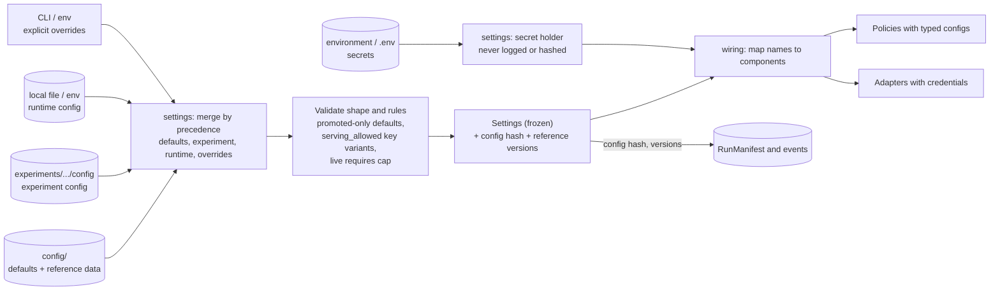

# Configuration Flow (Stage 3)

Status: the four layers, their separation, and the flow **decided**; precedence order **provisional**; file format, variable names, and loading library are **Stage 6** decisions. Last updated 2026-10-14.
Index: [architecture README](README.md). Components: CMP-19 (settings), CMP-20 (wiring). Requirements: MP§4 (configuration over code), QA-REPL, ADR-0002, ADR-0003.

---

## 1. Kinds of configuration

| Kind | What it holds | Where it lives | Versioned in git? | Who reads it |
|---|---|---|---|---|
| **Application defaults** | Strategy selection (promoted components only), thresholds, cache key variant, scope, overflow rule, retry and cascade limits, event sink choice. | `config/` | yes | settings |
| **Reference data** (a kind of default, versioned on its own) | Model catalogue (capabilities with verification, limits, tiers, equivalence groups), price tables (source, effective date, check date), label → model mapping, baseline definitions. Each file has its own version ID that events and manifests record. | `config/` | yes | settings |
| **Runtime configuration** | Machine- or deployment-specific values: data paths, run directory, sink location, run mode, whether live calls are allowed here, the spending cap, log level. | an untracked local file and/or environment variables | no | settings |
| **Experiment configuration** | Candidate strategy and parameters, dataset slice, seed, baselines, counterfactual source, metrics. | `experiments/<area>/<EXP-ID>/config.*` | yes | runner → settings |
| **Explicit overrides** | One-off overrides for a single invocation. | command-line arguments or environment variables | no | settings |
| **Secrets** | Provider credentials, the fingerprint key ([ADR-0015](../adr/0015-keyed-content-fingerprints.md)), future database passwords. | environment or an untracked `.env` only | **never** | settings → wiring → adapters |

---

## 2. Configuration flow

**Question answered:** how are the configuration layers loaded and merged, how do secrets travel separately, and how does configuration become running components?

---

## 3. Rules

1. **Precedence (provisional):** defaults < experiment < runtime < explicit overrides. The experiment states what it wants to test; the local runtime decides what this machine allows (paths, live calls, the cap). Stage 6 fixes the mechanism.
2. **Live calls need two keys.** A run makes live calls only if the experiment asks for the `live` counterfactual source **and** the runtime configuration enables live calls with a spending cap set. Otherwise wiring refuses to build a live client (ADR-0003).
3. **Defaults name only promoted components.** `settings` rejects a default that points outside `metis_auto` ([repository_structure.md §6.2](repository_structure.md#62-promotion-process-experiment--srcmetis_auto-decided)). Experiment configs may name candidate strategies, through the Stage 8 loading mechanism.
4. **Serving key variants** must carry `serving_allowed` ([caching.md §1](caching.md#1-cache-key-composition)).
5. **Settings know no policies.** `settings` validates shape and the cross-cutting rules above. Each policy's own config type lives with the policy in `domain`, and `wiring` maps the loaded settings onto it.
6. **Frozen and hashed.** The merged settings are immutable during a run. A hash of the non-secret settings, plus the version ID of each reference-data file, goes into every event envelope and manifest (FR-OBS-02, FR-EVAL-07).
7. **Secrets** are read only from the environment (with an optional untracked `.env` in local development), held in a wrapper that hides the value when printed, passed by `wiring` only to the adapters that need them, and never logged, put into events, or included in the config hash. Events and manifests may record *that* a secret was present, never its value.
8. **Unknown values stay unknown.** An unset premium baseline, an unverified capability, or a missing price is represented explicitly, and downstream results say "not computed" or "unsupported" rather than defaulting (ADR-0002, FR-ACCT-02, FR-ROUTE-05).

## 4. Open items (Stage 6 and 7)

- File format and the loading library.
- Environment-variable naming, and the `.env.example` contents (ADR-0003 point 4).
- The catalogue and price schema (Stage 7).
