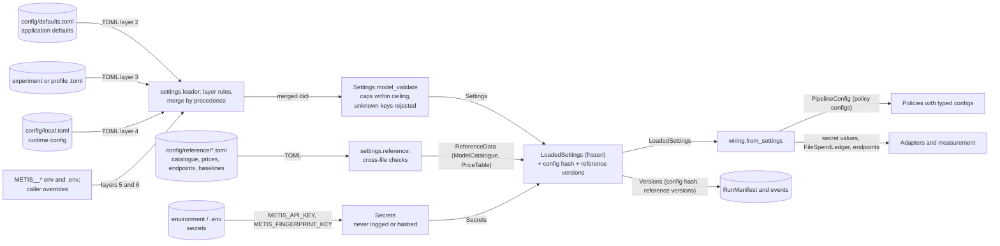

# Configuration Flow (Stage 3)

Status: the layers, their separation, the flow, the precedence, the file format (TOML), variable naming, and the loader **decided** in Stage 6 ([ADR-0019](../adr/0019-configuration-format-layers-and-secrets.md)); the `Settings` shape **provisional**; the catalogue and price **schema** provisional until Stage 7. Last updated 2026-10-18 (Stage 6).
Index: [architecture README](README.md). Components: CMP-19 (settings), CMP-20 (wiring). Requirements: MP§4 (configuration over code), QA-REPL, ADR-0002, ADR-0003, ADR-0018, ADR-0019. How-to: [local development guide](../guides/local_development.md).

---

## 1. Kinds of configuration

| Kind | What it holds | Where it lives | Versioned in git? | Who reads it |
|---|---|---|---|---|
| **Application defaults** | Strategy selection (promoted components only), thresholds, cache key variant, scope, overflow rule, retry and cascade limits, event sink choice, budget caps and the 20 USD ceiling. | `config/defaults.toml` (thresholds not listed there keep each policy's typed code default) | yes | settings |
| **Reference data** (a kind of default, versioned on its own) | Model catalogue (capabilities with verification, limits, tiers, equivalence groups), price tables (source, effective date, check date), provider endpoints (base URL per family), baseline definitions; later the label → model mapping. Each file has its own version ID that events and manifests record. | `config/reference/*.toml` | yes | settings |
| **Runtime configuration** | Machine- or deployment-specific values: data paths, run directory, ledger location, whether live calls are allowed here, lower caps, log level. | `config/local.toml` (untracked; example `config/local.example.toml`) or `METIS_RUNTIME_CONFIG` | no | settings |
| **Experiment configuration** | Candidate strategy and parameters, dataset slice, seed, baselines, counterfactual source, metrics. May not set `live`, `budget`, `paths`, `dev`. | `experiments/<area>/<EXP-ID>/config.toml`; run profiles in `config/profiles/` | yes | runner → settings |
| **Explicit overrides** | One-off overrides for a single invocation. | `METIS__<SECTION>__<KEY>` environment variables (process, then `.env`); caller-supplied dotted keys | no | settings |
| **Secrets** | `METIS_API_KEY` (one key for every family, ADR-0018), `METIS_FINGERPRINT_KEY` ([ADR-0015](../adr/0015-keyed-content-fingerprints.md)), `METIS_DB_PASSWORD` (future). | environment or an untracked `.env` only (template: `.env.example`) | **never** | settings → wiring → adapters / measurement |

---

## 2. Configuration flow

**Question answered:** how are the configuration layers loaded and merged, how do secrets travel separately, and how does configuration become running components?

---

## 3. Rules

1. **Precedence (decided, ADR-0019):** policy code defaults < `config/defaults.toml` < experiment < runtime file < `METIS__*` environment < caller overrides. The experiment states what it wants to test; the local runtime decides what this machine allows (paths, live calls, the caps), so an experiment file may not set `live`, `budget`, `paths`, or `dev`.
2. **Live calls need two keys.** A run makes live calls only if the experiment asks for the `live` counterfactual source **and** the runtime configuration enables live calls, with both caps set and `METIS_API_KEY` present. Otherwise wiring refuses to build a live client and lists every missing condition (ADR-0003, ADR-0018; `wiring.from_settings.live_permission`). The lifetime cap can never exceed `budget.lifetime_ceiling` (20 USD), which only `defaults.toml` may set.
3. **Defaults name only promoted components.** `settings` rejects a default that points outside `metis_auto` ([repository_structure.md §6.2](repository_structure.md#62-promotion-process-experiment--srcmetis_auto-decided)). Experiment configs may name candidate strategies, through the Stage 8 loading mechanism.
4. **Serving key variants** must carry `serving_allowed` ([caching.md §1](caching.md#1-cache-key-composition)).
5. **Settings know no policies.** `settings` validates shape and the cross-cutting rules above. Each policy's own config type lives with the policy in `domain`, and `wiring` maps the loaded settings onto it.
6. **Frozen and hashed.** The merged settings are immutable during a run. A hash of the non-secret settings (excluding machine-local `paths` and `logging`), plus the version ID of each reference-data file, goes into every event envelope and manifest (FR-OBS-02, FR-EVAL-07). Format: `cfg1:` + 16 hex.
7. **Secrets** (`METIS_API_KEY`, `METIS_FINGERPRINT_KEY`, `METIS_DB_PASSWORD`) are read only from the environment (with an optional untracked `.env` in local development), held in `Secrets` with pydantic's secret types, which hide the value when printed or dumped, passed by `wiring` only to the components that need them (provider adapters; the fingerprint key goes to the measurement service, CMP-02, Stage 5), and never logged, put into events, or included in the config hash. Events and manifests may record *that* a secret was present, never its value.
8. **Unknown values stay unknown.** An unset premium baseline, an unverified capability, or a missing price is represented explicitly, and downstream results say "not computed" or "unsupported" rather than defaulting (ADR-0002, FR-ACCT-02, FR-ROUTE-05).

## 4. Mechanism (Stage 6, ADR-0019)

| Item | Decision |
|---|---|
| File format | TOML (`tomllib`, standard library). Prices as decimal strings. |
| Loader | `metis_auto.settings.load_settings`; returns `LoadedSettings` (`settings`, `secrets`, `reference`, `config_hash`, `layers`, `root`). |
| Config directory | `METIS_CONFIG_DIR`, else `<checkout>/config`. Relative paths resolve against its parent. |
| Variable naming | Secrets: `METIS_API_KEY`, `METIS_FINGERPRINT_KEY`, `METIS_DB_PASSWORD`. Overrides: `METIS__<SECTION>__<KEY>`. Locations: `METIS_CONFIG_DIR`, `METIS_RUNTIME_CONFIG`. All listed in `.env.example`. |
| Layer rules | Ceiling only in defaults; no runtime sections in experiments; no secret-like keys anywhere; unknown keys rejected. |
| Reference files | `config/reference/`: `catalogue-metis-test.toml`, `prices-metis-2026-10-18.toml`, `endpoints-metis.toml`, `baselines.toml`; synthetic skeleton files. |
| Settings → components | `metis_auto.wiring.from_settings`: `pipeline_config`, `fingerprint_key`, `spend_ledger`, `live_permission`, `build_pipeline_from_settings`. |

**Still open (Stage 7):** the final catalogue and price schema (context-length tiers, cache writes, effective dates, the label mapping). Until then, a model whose prices need tiers keeps all its rows in `ReferenceData.pending_prices` and its costs are "not computed".
