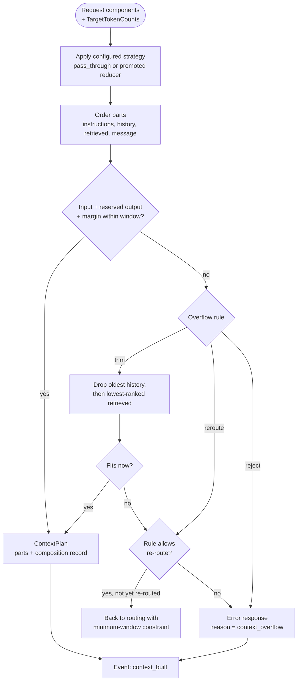

# Context Construction and Reduction (Stage 3)

Status: pass-through reference **decided**; reduction strategies **open** (they are experiments, FR-CTX-02); overflow rule **provisional**. Last updated 2026-10-14.
Index: [architecture README](README.md). Component: CMP-07 (context policy), with CMP-02 for token counts. Requirements: FR-CTX-01…05, H-1, H-2.

---

## 1. What the context stage does

For **one target model**, it turns the request's components into the ordered input parts that the model receives, and it records what it did. It runs once per distinct target: the first attempt, and again after a failover or escalation to a model with a different tokenizer or limit.

**Inputs**
- The `Request` components, each present, absent, or unknown: instructions, history (a list of turns), retrieved context (a list of strings), current message, attachment references, structured-input configuration.
- Token counts per component and per item (each history turn, each retrieved string), measured by CMP-02 with **the target's tokenizer** and labelled with fidelity.
- Target limits from the catalogue: context window, maximum output tokens, and provider prompt-caching properties (only when verified, FR-CTX-05).
- The context policy configuration.

**Outputs**
- `ContextPlan`: the ordered input parts, plus a **composition record** with one row per component: present/absent/unknown, size in tokens (and method), fingerprint, and action (`kept`, `trimmed`, `summarised`, `dropped`), plus the total and the overflow outcome (FR-CTX-01). The record has no content.

---

## 2. Steps

1. **Assemble** the components that are present. Unknown components are carried as unknown; they are never filled in or treated as empty (P-6).
2. **Apply the strategy** (selected by configuration):
   - `pass_through` (reference, decided): keep everything in its logged or supplied form.
   - Experimental (FR-CTX-02; live in `experiments/context/` until promoted): history window (last *N* turns or last *T* tokens); history summary (the summary is a model call, so it is a *measurement* by CMP-02 and its cost is overhead); retrieved-context trimming (top-*k* strings or a token budget); instruction deduplication or compaction.
3. **Order** the parts. Default order: instructions → history → retrieved context → current message. This keeps the most stable text first, which is the precondition for provider-side prompt caching (H-1). Whether a provider gives a discount, and for what minimum prefix, comes only from verified documentation with a source and check date (FR-CTX-05). The architecture assumes nothing about it.
4. **Check the budget**: input tokens + reserved output tokens + a safety margin ≤ the target's context window.
5. **Overflow rule** (FR-CTX-04; configured, provisional default `trim_then_reroute`):
   - `trim`: drop the oldest history turns, then the lowest-ranked retrieved strings, until the input fits. Instructions and the current message are never trimmed by this rule.
   - `reroute`: ask routing for a target with a larger window (one re-route per request, [lifecycle §1](request_lifecycle.md#1-stages)).
   - `reject`: return an error response.
   - `trim_then_reroute`: trim within configured limits; if it still doesn't fit, reroute.
6. **Emit** `context_built` with the composition record.

---

## 3. Context construction flow

**Question answered:** how do the request's components become the model input for one target, and what happens when they don't fit?

---

## 4. Evidence requirements

- No reduction strategy is promoted without a quality-preserving ablation against `pass_through`: judge score or non-inferiority, overall and per stratum (FR-CTX-03, ADR-0006).
- Offline cost estimates depend on an **assumed prompt composition**, because the real one is unknown (U-04, A-03). Every run manifest records the assumption, for example "logged instructions sent as instructions; full logged history; logged retrieved context". Results are not comparable across different assumptions.
- In replay, a retrieved-context string may be truncated in the log (A-14). The context policy treats it as given. Whether a component may be truncated is a data-quality flag from the data source, not a policy concern.

## 5. Open items

- Which strategies to test, with which parameters: the Stage 8 context plan.
- The default overflow rule and safety margin (configuration).
- Whether instructions may ever be trimmed or compacted: only with a decision record backed by ablation evidence.
