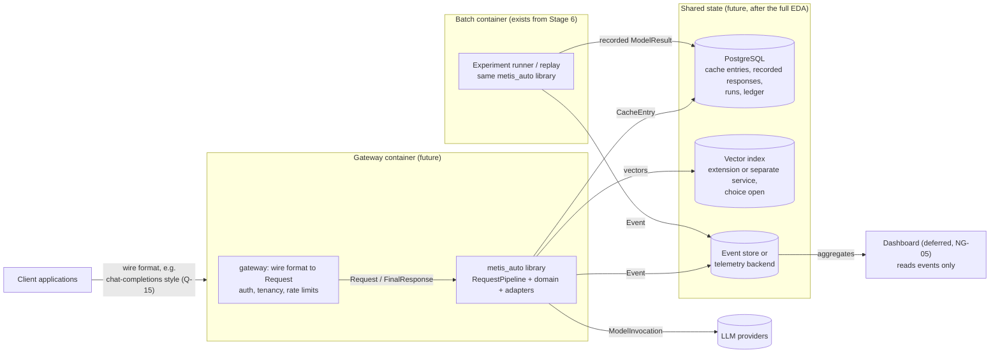

# Local Development, Future Deployment, and Future Database (Stage 3)

Status: local-development assumptions **decided**; the future deployment view and database integration are **provisional extension points**, not designs. Last updated 2026-10-14.
Index: [architecture README](README.md). Requirements: ADR-0005, NG-01…03, NG-13, FR-DATA-02, 04, 05, FR-XCACHE-08, FR-OBS-06.

---

## 1. Local development assumptions (current)

| Assumption | Status | Consequence |
|---|---|---|
| One developer machine (macOS today), Python 3.13 venv from a non-conda interpreter (ADR-0001, TODO-08). | decided | Docker (Stage 6) gives the same runtime on other machines. |
| **No network and no keys** for the default test suite and the walking skeleton. | decided | Fakes for every port; tests marked `network` are skipped unless explicitly enabled (QA-TEST). |
| One process. The pipeline is a library call; replay and tests call it directly. | decided | No server, queue, or database is needed now (NG-03). |
| CPU only. | provisional | Local embedding models (Stage 8) must run acceptably on CPU, or their experiments are run elsewhere and recorded. |
| Data paths come from runtime configuration. Only `data_access` reads them. | decided | Moving to the full dataset or a database changes config and `data_access`, nothing else (FR-DATA-04). |
| Runs write to `runs/` (gitignored). Reports are curated by hand into `reports/`. | decided | No content is committed. |
| Overhead timings from this machine are indicative only (A-22). | decided | Hardware recorded in every manifest. |

---

## 2. Current runtime view

There is a single process: a test, a script, or a notebook calls `wiring`, which builds a pipeline with fake or replay adapters, in-memory stores, and a JSON Lines sink, then runs it. Stage 6 adds a container that runs the same thing. An optional PostgreSQL service is added to Compose only once Stage 9 needs it.

---

## 3. Future deployment and container view

**Question answered:** when Metis serves live traffic, which deployable units are there, which state do they share, and which parts of today's code does each one reuse? (Extension point only; NG-01, NG-13.)

What this view commits to now: the gateway is a **separate adapter layer** over the same library (FR-API-03); every shared store sits behind a port that already exists; the dashboard reads events only. Everything else in the view is open: which store, horizontal scaling, secrets management, and how the gateway is hosted.

---

## 4. Future database integration (extension point, not a schema)

No persistent schema is designed before the full dataset is inspected (FR-DATA-05, NG-02). What exists now is the set of ports a database would sit behind:

| Port | Adapter now | Possible persistent adapter | What decides it |
|---|---|---|---|
| `DataSource` | sample-file loader, synthetic generator | full-dataset loader; database repository | the full EDA (Stage 9) |
| `CacheStore` | in-memory | PostgreSQL table | the full-data cache experiments |
| `VectorIndex` | in-memory | a database vector extension or a separate index | semantic-cache experiments; the embedding size and volume |
| `EventSink` | in-memory, JSON Lines | database table or telemetry exporter | the online phase and dashboard needs |
| `SpendLedger` | in-memory per run | a file or database row for cumulative caps | the first multi-run live budget |
| Recorded responses (replay client) | files under `data/recorded/` | database table | the volume of recorded answers |

**Candidate entities (provisional, for orientation only):** session, message, request (replay case), model call (attempt), cache entry, event, run, recorded response, label mapping. Fields, keys, and indexes are designed in Stage 9 and later, from the full dataset's real schema. The index needs the master prompt lists (by session, time, model, normalised-request group, embeddings) are inputs to that work.

A database adapter belongs in `adapters` (stores, sinks) or `data_access` (dataset repositories). Database drivers are imported only there (repository_structure.md §3.3).
