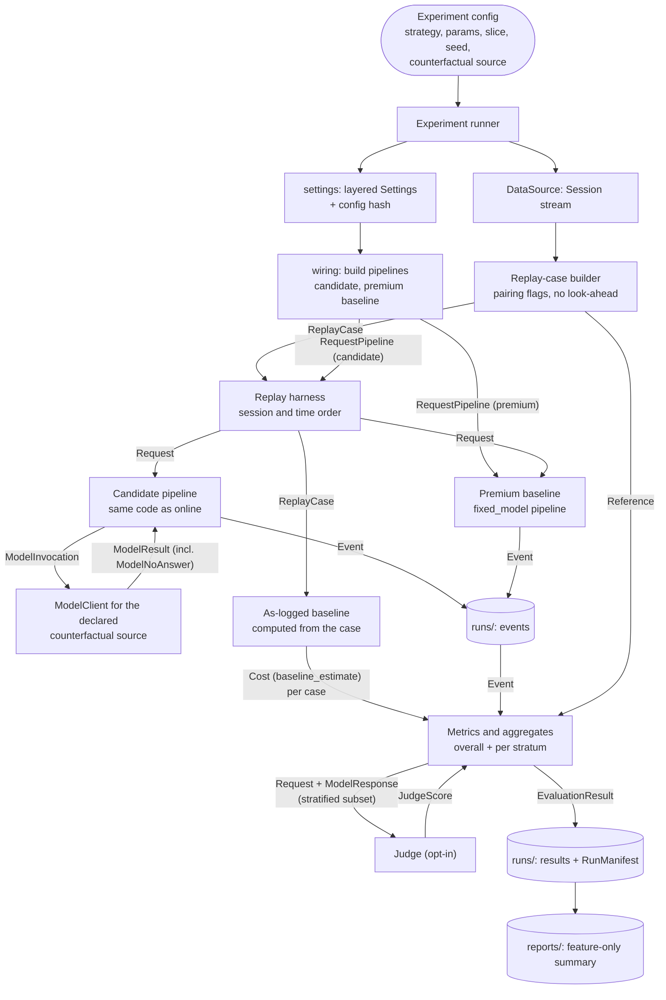

# Offline Evaluation Flow (Stage 3)

Status: structure **decided** ([ADR-0014](../adr/0014-counterfactual-answers-via-model-client.md)); runner, strategy loading, EXP-IDs, and the comparison format **decided** in Stage 8 ([ADR-0022](../adr/0022-experiment-runner-and-run-tracking.md), [framework.md](../experiments/framework.md)). Last updated 2026-10-18.
Index: [architecture README](README.md). Components: CMP-21 (replay), CMP-22 (baselines), CMP-23 (metrics), CMP-24 (runner), CMP-18 (data sources). Requirements: FR-EVAL-*, [ADR-0002](../adr/0002-configurable-baselines.md), [ADR-0006](../adr/0006-evaluation-metric-definitions.md).

---

## 1. What a run is

An **experiment run** evaluates one candidate configuration (strategies, parameters) over one dataset slice and compares it with the baselines. It writes:
- events for every replayed request, to the sink under `runs/<EXP-ID>/<run-id>/`;
- a `RunManifest`: config hash, code version (commit and dirty flag), data hash, seed, component versions (policies, feature set, catalogue, price table, embedder, judge), the counterfactual source, the prompt-composition assumption, ordering rule, hardware;
- an `EvaluationResult`: metrics overall and per stratum, with sample sizes and intervals.

Only curated, feature-only summaries go to `reports/` (ADR-0009).

---

## 2. Offline evaluation flow

**Question answered:** how does an experiment config become comparable results against both baselines, and which parts reuse the production pipeline?

The candidate and premium baseline run through the real `RequestPipeline` (P-2). Only the injected adapters and the configuration differ. `evaluation` receives the pipelines from `wiring` through factories; it never imports `wiring` (ADR-0009).

---

## 3. Replay rules

- **Cases** come from the `DataSource` via the replay-case builder (CMP-18, re-implemented, not taken from the EDA helpers, FR-DATA-08). A `ReplayCase` holds the request as it would have been seen at that turn, the reference answer(s), the pairing-quality flag, and logged metadata (model label, presence flags).
- **No look-ahead** (FR-REQ-06): a case contains only what came before its turn. The reference is visible to metrics only, never to the pipeline.
- **Order.** Within a session: array order. Across sessions, for cache experiments that measure cross-session reuse: by the logged message timestamp, which is naive with an unknown timezone (A-06). The ordering rule is recorded in the manifest.
- **Pairing flags** (FR-REQ-03): `clean`, `multiple_answers` (renamed from `multiple_bots` in Stage 4, because `bot` is a sample role name), `skipped_consecutive_user`, `unanswered` (Stage 8: a user message with no answer before the log ends; 15 in the sample). Implemented in `data_access/replay_cases/builder.py` (latest preceding user message in log order, A-04). An answer with `no_preceding_user` never becomes a case; it is counted as an exclusion. The run config says which flags are included. Excluded and flagged counts are reported (FR-EVAL-08). Contracts: `ReplayCase`, `PairingFlag`, `ExclusionCount` ([contracts.md §4](contracts.md#4-tolerating-the-sample-without-baking-it-in-fr-data-06-adr-0008)).
- **Cache state** is reset at the start of each run, and evolves in replay order.

---

## 4. Counterfactual sources and their limits

The data contains only the answer of the model that was actually used. Each run declares one source for answers from other models (FR-EVAL-04, context §8). The source is chosen by injecting a `ModelClient` adapter ([ADR-0014](../adr/0014-counterfactual-answers-via-model-client.md)).

| Source | Adapter | What it gives | What it costs | Risks |
|---|---|---|---|---|
| `fake` | fake client | Exercises flow, overhead, routing mix, and cost *shape*. No quality signal. | free | Results say nothing about quality. |
| `logged_match` | replay client backed by references | The logged answer, **only** when the target maps (by curated label mapping) to the logged model. Otherwise "no answer". | free | Coverage is biased toward requests routed to the logged model. Mapping fidelity matters (FR-ACCT-07). |
| `recorded` | replay client backed by `data/recorded/` | Answers recorded earlier from live calls, keyed by case fingerprint × model × composition fingerprint. | free after recording | Only as complete as what was recorded. Stale if models change. |
| `live` | live client wrapped by the recording decorator | Real answers, usage, and latency. Recorded for reuse. | money; data leaves the machine | Opt-in, spending cap, privacy review (ADR-0003). Non-deterministic. |
| `proxy` | none (no answers) | Cost and overhead estimates only. | free | Weakest; no quality. |

**Coverage.** Every run reports the fraction of cases for which the declared source produced an answer. Quality metrics are computed over covered cases only, with the selection bias stated.

**History divergence.** In replay, history is the *logged* history, including the logged model's earlier answers, not the candidate's own earlier answers. Multi-turn effects of a different routing choice are therefore not simulated. Every manifest states this.

---

## 5. Baselines

| Baseline | How it is computed | Quality | Cost | Latency |
|---|---|---|---|---|
| **As-logged** (mandatory) | From each `ReplayCase`: logged answer, logged label mapped to a catalogue model with a fidelity (FR-ACCT-07). No pipeline run. | It *is* the reference, so agreement is trivially 1. Judge scores are possible. | Tokens estimated with the mapped model's tokenizer on the assumed composition; price from the table. Unmapped labels (`default`, `workflow`, null) → "not computed". | unmeasured (no latency in the data) |
| **Premium** | A pipeline with the `fixed_model` policy on the configured premium model (currently a placeholder) and no cache. | Needs premium answers (`recorded` or `live`); otherwise "unmeasured". | Estimated on the same composition. Unset premium → "not computed" (ADR-0002). | live or recorded only |
| Others (e.g. always-cheapest) | Configuration: another `fixed_model` pipeline. | as above | as above | as above |

Savings = baseline cost − candidate cost, per baseline, with both methods and versions stated (FR-ACCT-05).

---

## 6. Metrics and judges

- Metric definitions follow ADR-0006: agreement, judge score, and non-inferiority kept separate; hit rate with hit correctness; cost with fidelity; overhead latency separate from model and end-to-end latency.
- Metrics are computed **from events plus references**, so the same aggregation code serves the deferred dashboard (FR-OBS-05, [observability.md](observability.md)).
- Strata (FR-EVAL-06): opaque category, language, length bucket, turn depth, and presence of retrieved context, instructions, and attachments. Sample sizes and bootstrap intervals are reported (FR-EVAL-09).
- **Judges** are pluggable through the `Judge` port and versioned. An LLM judge is opt-in. It runs on a stratified subset, and its cost is **evaluation cost**, reported separately from request cost. A judge used as a *runtime detector* is request overhead instead ([attempts.md §4](attempts.md#4-detecting-an-unsatisfactory-response)). Calibration against human ratings is planned (TODO-05).
- Agreement uses a Persian-capable `Embedder`, chosen and verified in Stage 8 (ADR-0006).

## 7. Open items

Resolved in Stage 8 (framework.md): the strategy-loading mechanism (A-26), the comparison format, and `EXP-ID` naming; the as-logged baseline (label mapping) and the `logged_match` and `recorded` replay clients exist. Still open:

- Which judge, which embedder, and which proxy labels each routing approach needs.
