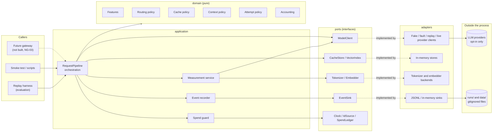

# Architecture Overview and Component Catalogue (Stage 3)

Status: **provisional** as a whole until Stage 3 review. Each element carries its own status (*decided*, *provisional*, *open*). Last updated 2026-10-14.
Index: [architecture README](README.md). Related: [requirements](../project/requirements.md) · [repository structure](repository_structure.md) · [ADR-0010 pipeline shape](../adr/0010-request-pipeline-shape.md).

This document answers: **what are the components, what does each one own, what goes in and out, and where does it live?** The flow documents linked from the [index](README.md) explain how the components work together for each mechanism.

---

## 1. Architectural principles

These principles apply everywhere. Each flow document refers back to them.

| ID | Principle | Status | Traces |
|---|---|---|---|
| P-1 | **Measure in `application`, decide in `domain`.** Everything that touches a port (token counts, embeddings, model calls made by a router or judge, clocks, stores) is a *measurement* taken by the application layer. Domain policies receive the measurements as plain data and return decisions. Domain code therefore never calls a port, never does I/O, and is deterministic given its inputs. | decided | MP§4, FR-FEAT-04, FR-ROUTE-07, QA-TEST |
| P-2 | **One pipeline for replay and online.** The offline replay harness and the future gateway call the same `RequestPipeline` with different injected adapters. There is no separate "simulation" code path. | decided | FR-ROUTE-07, FR-EVAL-01, FR-OBS-03 |
| P-3 | **Every decision is an event.** Each stage emits a structured, request-correlated event. Metrics, the deferred dashboard, and evaluation results are all derived from events ([ADR-0012](../adr/0012-event-stream-as-measurement-record.md)). | decided | FR-OBS-01…05 |
| P-4 | **Configuration over code.** Strategy selection, thresholds, chains, the catalogue, prices, and baselines are configuration ([configuration.md](configuration.md)). | decided | MP§4, QA-REPL |
| P-5 | **Conservative by default.** The serving defaults are the full cache key, `session` scope, verified-only capabilities, and no live calls. Anything looser exists for measurement until evidence justifies it. | decided | FR-XCACHE-02, FR-ROUTE-05, ADR-0003, ADR-0007 |
| P-6 | **Unknown is not absent.** Every optional request component has three states: present, absent, or unknown. "Unknown" never matches a cache key and never counts as "no context". | decided | FR-REQ-01, FR-REQ-04 |
| P-7 | **Content stays inside a small boundary.** Raw content exists only in memory on the request path, in the cache store, in the gitignored data folders, and, with opt-in only, in requests to live providers or judges. Events, logs, and reports carry keyed fingerprints and derived values ([ADR-0015](../adr/0015-keyed-content-fingerprints.md), [data flow](request_lifecycle.md#4-data-flow-and-privacy-boundary)). | decided (boundary); provisional (keyed fingerprints, Q-20) | QA-PRIV, A-09 |
| P-8 | **The pipeline is stateless about conversations.** The caller supplies the history with each request. The pipeline holds no session state, apart from what is in the cache store and the spend ledger. | provisional | FR-API-01, FR-API-03 (chat-completions style is also stateless) |

---

## 2. High-level architecture

**Question answered:** what are the main parts of the system, which layer does each belong to, and where are the boundaries to the outside world?

`wiring` (the composition root) builds every box in `application` and `adapters` from `settings` and injects the adapters through the ports. It is left out of the diagram because it acts only at start-up. The dependency view between packages is in [repository_structure.md §3.1](repository_structure.md#31-allowed-imports-inside-srcmetis_auto-decided).

---

## 3. Component catalogue

Every component has an owner responsibility, inputs, outputs, and dependencies. **Contract names** in the Inputs and Outputs columns are the provisional vocabulary in §5. Stage 4 fixes their fields.

`CMP-nn` IDs are used in the flow documents and later in the module reference (Stage 5).

### 3.1 Request path

| ID | Component | Home | Owns (responsibility) | Inputs | Outputs | Depends on | Status | Traces |
|---|---|---|---|---|---|---|---|---|
| CMP-01 | **Request pipeline** | `application/pipeline` | Runs the stages in a fixed order ([lifecycle](request_lifecycle.md)): features → routing → cache → context → attempt loop → store → respond. Holds no decisions. | `Request` | `FinalResponse` | CMP-02…09, CMP-17; ports `CacheStore`, `VectorIndex`, `ModelClient` | decided (order), provisional (internals) | FR-API-01, FR-OBS-01, ADR-0010 |
| CMP-02 | **Measurement service** | `application/measurement` | Takes every measurement that needs a port: content fingerprints, token counts per component for a target model, embeddings, model-based features (e.g. semantic intent), judge scores used as runtime detectors. Records each measurement's method, fidelity, cost, and duration. | `Request`, target model | `RequestMeasurements`, `TokenUsage` | ports `Tokenizer`, `Embedder`, `ModelClient`, `Judge`, `Clock` | provisional | P-1, FR-ROUTE-04, FR-SCACHE-05, FR-ACCT-01 |
| CMP-03 | **Event recorder** | `application/events` | Builds events with correlation IDs, spans, durations, and versions, then hands them to the sink. Checks that payloads carry no raw-content fields. | stage outcomes | `Event` | ports `EventSink`, `Clock`, `IdSource` | decided | FR-OBS-01…03, QA-PRIV |
| CMP-04 | **Feature extractor** | `domain/features` | Pure feature functions: language/script mix (tested detector), length, code presence, attachment presence/type/count, turn depth, history size, instruction presence/size/group, RAG presence/size, structured-input proxy. Also hosts request normalisation variants. Semantic intent is a *measured* input. | `Request`, `RequestMeasurements` | `RequestFeatures` (with feature-set version) | contracts only | decided (shape), provisional (feature set) | FR-FEAT-01…05, FR-XCACHE-03 |
| CMP-05 | **Routing policy** | `domain/routing` | A shared eligibility filter (capabilities, context fit, modality), then a selectable policy (fixed-model, rule-based now) that chooses the target ([routing.md](routing.md)). | `RequestFeatures`, `ModelCatalogue`, policy config, constraints | `RoutingDecision` | contracts only | decided | FR-ROUTE-01…07 |
| CMP-06 | **Cache policy** | `domain/caching` | Eligibility, key composition, validity rules at lookup and store, the semantic match decision, and store-write rules ([caching.md](caching.md)). | `Request`, `RequestFeatures`, `RoutingDecision`, stored-entry metadata, similarity scores | `CacheKey`, `CacheLookupResult`, store decision | contracts only | decided (structure), provisional (rules) | FR-XCACHE-*, FR-SCACHE-*, ADR-0011 |
| CMP-07 | **Context policy** | `domain/context` | Builds the model input from request components for one target: keep, trim, summarise (via a measured summary), drop, order. Applies the overflow rule ([context_construction.md](context_construction.md)). | `Request`, per-component token counts for the target, target limits | `ContextPlan` (input parts + composition record) | contracts only | decided (pass-through reference), open (strategies) | FR-CTX-01…05 |
| CMP-08 | **Attempt policy** | `domain/attempts` | Decides the next action after each attempt: invoke a target (primary, retry, failover, escalation), return an answer, or fail. Hosts the unsatisfactory-response detectors and how their verdicts are combined ([attempts.md](attempts.md)). | `AttemptState` (decision, chain, attempt outcomes, deadline and budget left) | `AttemptAction`, `DetectorVerdict` | contracts only | decided (model), open (detectors) | FR-CASC-*, FR-FAIL-*, ADR-0013 |
| CMP-09 | **Accounting** | `domain/accounting` | Cost from usage and prices, request cost totals across attempts and overhead, avoided cost on cache hits, savings against baselines, the pre-call estimate for the spend cap. "Not computed" when a price is unknown. | `TokenUsage`, `PriceTable`, `ModelCatalogue` | `Cost`, `CostEstimate`, `Savings` | contracts only | decided | FR-ACCT-01…07, ADR-0002 |
| CMP-17 | **Spend guard** | `application/pipeline` | Before every live invocation, compares the pre-call estimate with what is left under the cap; blocks and emits an event when the cap would be exceeded. | `CostEstimate`, ledger balance | allow / block | CMP-09; port `SpendLedger` | decided | ADR-0003, FR-ACCT-06 |

### 3.2 Ports and adapters (infrastructure)

| ID | Port (`ports`) | Adapters now (`adapters`) | Later | Owns | Status | Traces |
|---|---|---|---|---|---|---|
| CMP-10 | `ModelClient` | Fake (canned synthetic answers), fault-injecting decorator, replay client (recorded or logged answers), recording decorator | Live client per provider family (opt-in) | Normalising provider requests, responses, usage, finish reasons, and errors into contracts ([providers.md](providers.md)). | decided | FR-API-02, FR-FAIL-06, ADR-0003, ADR-0014 |
| CMP-11 | `CacheStore`, `VectorIndex` | In-memory | PostgreSQL (and a vector extension or another index, decided after the full EDA) | Holding entries and vectors; lookup by key and by partition plus similarity. No validity logic. | decided (interface) | FR-XCACHE-08, FR-SCACHE-03 |
| CMP-12 | `Tokenizer` | Approximation backend; exact local backends added in Stage 7 | Provider counting APIs (opt-in, network) | Counting tokens for a model family, labelled with fidelity. | decided (interface) | FR-ACCT-01, H-7 |
| CMP-13 | `Embedder` | Deterministic fake embedder | Persian-capable embedding backends (chosen in Stage 8) | Text → vector, with embedder ID and version. | decided (interface) | FR-SCACHE-03, ADR-0006 |
| CMP-14 | `EventSink` | In-memory, JSON Lines file under `runs/` | Database or metrics/tracing exporter | Durable, ordered delivery of events. | decided (interface) | FR-OBS-06 |
| CMP-15 | `Judge` | Fake judge | LLM judge (uses a `ModelClient`), human-label import | Scoring an answer on a rubric, with judge ID and version. | provisional | FR-EVAL-05, FR-CASC-02 |
| CMP-16 | `Clock`, `IdSource` | System clock, fake clock; random and seeded ID sources | — | Wall time (UTC), monotonic durations, IDs. Seeded sources make replay reproducible. | decided | FR-REQ-02, QA-REPRO |
| CMP-26 | `SpendLedger` | In-memory per run | File or database ledger for cumulative caps | The running total of live spend. | provisional | ADR-0003 |

### 3.3 Data, configuration, evaluation, composition

| ID | Component | Home | Owns | Inputs | Outputs | Depends on | Status | Traces |
|---|---|---|---|---|---|---|---|---|
| CMP-18 | **Data sources** | `data_access` | Reading datasets behind the `DataSource` port. Sample loader (all sample quirks live here), re-implemented pairing heuristic with pairing-quality flags, replay-case builder, synthetic generator; later the full-dataset loader. | dataset paths (config) | `Session`, `ReplayCase` | ports `DataSource` | decided (interface) | FR-DATA-01…08, FR-REQ-03…06 |
| CMP-19 | **Settings loader** | `settings` | Loading and layering defaults, runtime config, experiment config, overrides, and secrets; validation; config hash ([configuration.md](configuration.md)). | files, environment | `Settings`, `ModelCatalogue`, `PriceTable` | contracts only | decided (layers), provisional (format) | MP§4, ADR-0003 |
| CMP-20 | **Composition root** | `wiring` | Building pipelines, runners, and data sources from settings. Maps strategy names to promoted components. Refuses to build a live client without a spending cap. | `Settings`, secrets | built objects | every package | decided | QA-REPL, ADR-0003, ADR-0009 |
| CMP-21 | **Replay harness** | `evaluation/replay` | Feeding `ReplayCase`s to a pipeline in session and time order without look-ahead; attaching references; recording counterfactual coverage ([evaluation.md](evaluation.md)). | `ReplayCase` stream, pipeline factory | per-case outcomes, events | `application`, ports | decided | FR-EVAL-01, FR-REQ-06, ADR-0014 |
| CMP-22 | **Baselines** | `evaluation/baselines` | As-logged (computed from the case) and premium (fixed-model pipeline). "Not computed" when unset. | `ReplayCase`, settings | baseline outcomes | CMP-09, CMP-02 | decided | FR-EVAL-02, ADR-0002 |
| CMP-23 | **Metrics and aggregates** | `evaluation/metrics` | Computing ADR-0006 metrics and FR-OBS-05 aggregates from events, overall and per stratum, with sample sizes and intervals. | events, references, judge scores | `EvaluationResult` | ports `Judge`, `Embedder` | decided | FR-EVAL-03, 06, 09, FR-OBS-05 |
| CMP-24 | **Experiment runner** | `evaluation/runner` | Running an experiment config against candidate and baselines; writing the run manifest and results to `runs/`. Strategy-loading mechanism decided in Stage 8. | experiment config | `RunManifest`, `EvaluationResult` | CMP-21…23 | provisional | FR-EVAL-07, QA-REPRO |
| CMP-25 | **Dataset profiling** | `analysis` | Tested profiling for the full EDA and onboarding checks. | `Session` stream | profile tables (feature-only) | ports `DataSource`, `domain` | future | FR-DATA-07 |

### 3.4 Deferred components (documented, not built)

| ID | Component | Home | Why deferred | Traces |
|---|---|---|---|---|
| CMP-F1 | Network gateway: wire format ↔ internal contracts, auth, tenancy | `gateway/` (future, same import rights as `wiring`) | NG-03, Q-15 | FR-API-03 |
| CMP-F2 | Dashboard: a reader of event stores and aggregates, never on the request path | decided when Action 3 returns | NG-05 | FR-FIN-02, FR-OBS-05 |
| CMP-F3 | Provider health tracker (circuit breaker); the attempt policy would read a health snapshot as data | `application` state + a `ProviderHealth` port | FR-FAIL-05 is future | FR-FAIL-05 |
| CMP-F4 | Persistent stores (cache, events, recorded responses, runs) | `adapters` / `data_access` | needs the full dataset (NG-02) | FR-DATA-05, FR-XCACHE-08 |

---

## 4. Component interaction

**Question answered:** during one request, which component calls which, and what contract crosses each call? (The lifecycle [sequence diagram](request_lifecycle.md#2-request-lifecycle-sequence) shows the same calls in time order.)

```mermaid
%% Question: during one request, which component calls which, and what contract crosses each arrow?
flowchart TD
    caller["Caller"] -- "Request" --> pipe["CMP-01 RequestPipeline"]
    pipe -- "Request" --> meas["CMP-02 Measurement"]
    meas -- "RequestMeasurements" --> pipe
    pipe -- "Request + RequestMeasurements" --> feat["CMP-04 Features"]
    feat -- "RequestFeatures" --> pipe
    pipe -- "RequestFeatures + ModelCatalogue" --> route["CMP-05 Routing"]
    route -- "RoutingDecision" --> pipe
    pipe -- "Request + RoutingDecision" --> cpol["CMP-06 Cache policy"]
    cpol -- "CacheKey" --> pipe
    pipe -- "CacheKey" --> store["CacheStore / VectorIndex"]
    store -- "CacheEntry or none" --> pipe
    pipe -- "CacheEntry + similarity" --> cpol
    cpol -- "CacheLookupResult" --> pipe
    pipe -- "Request + token counts" --> ctx["CMP-07 Context policy"]
    ctx -- "ContextPlan" --> pipe
    pipe -- "AttemptState" --> att["CMP-08 Attempt policy"]
    att -- "AttemptAction" --> pipe
    pipe -- "CostEstimate" --> guard["CMP-17 Spend guard"]
    pipe -- "ModelInvocation" --> mc["ModelClient"]
    mc -- "ModelResult" --> pipe
    pipe -- "TokenUsage + PriceTable" --> acct["CMP-09 Accounting"]
    acct -- "Cost" --> pipe
    pipe -- "stage outcomes" --> recd["CMP-03 Event recorder"]
    recd -- "Event" --> sink["EventSink"]
    pipe -- "FinalResponse" --> caller
```

---

## 5. Provisional contract vocabulary

The flow documents label arrows with these names. **Stage 4 decides fields, types, privacy classes, and final names.** A rename in Stage 4 must update the diagrams too.

| Name | What it carries | Produced by | Consumed by |
|---|---|---|---|
| `Request` | Current message plus optional components (history, instructions, retrieved context, attachment references, structured-input config), each present/absent/unknown; session reference; optional privacy-safe user reference; optional requested model. | caller, CMP-18 | CMP-01 |
| `RequestMeasurements` | Content fingerprints, token counts per component (with fidelity), optional embedding reference, measured model-based features. | CMP-02 | CMP-04, CMP-06, CMP-07 |
| `RequestFeatures` | Derived features with feature-set version. | CMP-04 | CMP-05, CMP-06, CMP-23 |
| `ModelCatalogue`, `PriceTable` | Versioned reference data (models, capabilities with verification, limits, tiers, equivalence groups; prices with source and dates). | CMP-19 | CMP-05, CMP-08, CMP-09 |
| `RoutingDecision` | Target, eligible candidates, exclusions with reasons, policy name and version, reason code, feature references. | CMP-05 | CMP-01, CMP-06, CMP-08 |
| `CacheKey` | Key variant, schema version, component fingerprints or states, scope, partition key. | CMP-06 | CacheStore |
| `CacheEntry` | Stored answer (content), key, producing model, creation time, status, versions. | CacheStore | CMP-06 |
| `CacheLookupResult` | Eligibility (and reason), exact/semantic, hit/miss, entry ID, similarity and threshold. | CMP-06 | CMP-01 |
| `ContextPlan` | Ordered input parts for one target plus the composition record (per component: size, fingerprint, action). | CMP-07 | CMP-01, ModelClient |
| `AttemptState`, `AttemptAction` | Attempt history and limits; the next action with its kind and reason. | CMP-01 / CMP-08 | CMP-08 / CMP-01 |
| `ModelInvocation` | Target model, input parts, attachment references, generation limits, IDs, timeout. | CMP-01 | ModelClient |
| `ModelResult` | Either a response (text, normalised finish reason, usage, provider latency) or a normalised error (class, retryable). | ModelClient | CMP-01, CMP-08 |
| `DetectorVerdict` | Detector ID, value, threshold, fired or not. | CMP-08 | CMP-01, events |
| `TokenUsage`, `Cost`, `CostEstimate`, `Savings` | Counts with fidelity; money with price source and version, or "not computed". | CMP-02, CMP-09 | CMP-01, CMP-23 |
| `FinalResponse` | Answer (or error) plus `ResponseMetadata`: served-by, model, attempts, tokens, cost, overhead, spans, versions. | CMP-01 | caller |
| `Event` | Envelope (IDs, type, time, span, versions, run mode) plus a typed, content-free payload ([observability.md](observability.md)). | CMP-03 | EventSink, CMP-23 |
| `Session`, `ReplayCase` | A logged session; one replayable request with its reference answer(s), pairing flag, and logged metadata. | CMP-18 | CMP-21, CMP-25 |
| `EvaluationResult`, `RunManifest` | Metrics per stratum with sizes and states; run identity and versions. | CMP-23, CMP-24 | reports |
| `Settings` | Validated, frozen configuration plus config hash; secrets held separately. | CMP-19 | CMP-20 |

---

## 6. Fit with the repository structure (A-25)

**Result:** every component maps onto an existing ADR-0009 layer. **No new layer is needed** and the import table is unchanged. A-25 is confirmed.

Stage 3 proposes two adjustments. Neither has been applied to the import rules or the test.

**Proposal S3-1 (applied to the docs; was provisional anyway): sub-package names.** The provisional sub-packages in [repository_structure.md §2](repository_structure.md#2-the-package-srcmetis_auto) become:

| Package | Sub-packages (created in Stage 5) |
|---|---|
| `domain` | `features`, `routing`, `caching`, `context`, `attempts` (replaces the earlier `escalation`: it covers escalation, failover, and retries together, per [ADR-0013](../adr/0013-unified-attempt-model.md)), `accounting` |
| `application` | `pipeline` (CMP-01, CMP-17), `measurement` (CMP-02), `events` (CMP-03) |
| `adapters` | `providers`, `stores`, `tokenizers`, `embedders`, `sinks`, `judges`, `system` (clock, IDs, ledger) |
| `data_access` | `sample`, `synthetic`, `replay_cases`; later `full` |
| `evaluation` | `replay`, `baselines`, `metrics`, `runner` |

The `ports` list also grows within its stated purpose: `IdSource`, `VectorIndex`, and `SpendLedger` join the ports named in Stage 2.

**Proposal S3-2 (needs your approval; not applied): tighten `domain` to import only `contracts`.** Under P-1, domain code never calls a port, so it never needs to import `ports`. Removing the `domain → ports` edge would make "no I/O in domain" machine-checked instead of a review rule. Cost: a promoted strategy that wants a port type has to receive plain data instead, which is the intended design anyway. If approved, the change is one line in the `ALLOWED` table of `tests/architecture/test_import_rules.py`, one row in repository_structure.md §3.1, and an amendment note on ADR-0009. Tracked as Q-19.

---

## 7. Open items from this document

- Q-19: approve or reject proposal S3-2.
- P-8 (stateless pipeline) is provisional until the gateway's wire format is chosen (Q-15).
- Model-based features (semantic intent) are measured by CMP-02. Which method to use is open (FR-FEAT-02), and is a Stage 8 experiment.
