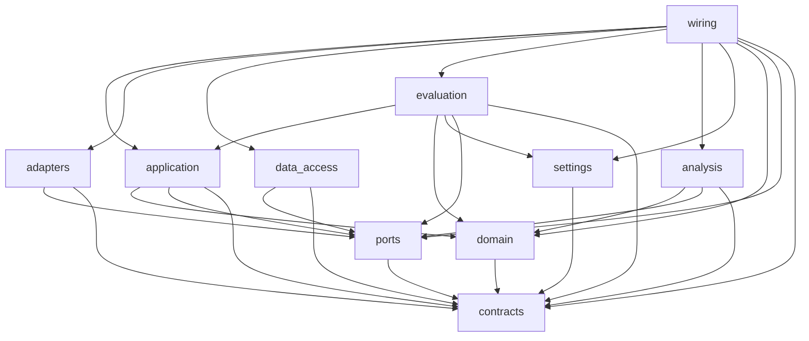

# Repository Structure and Dependency Rules (Stage 2)

Status: **decided** for the top-level layout and the dependency rules; **provisional** for sub-package names inside `src/metis_auto/` (refined by Stage 3, created in Stage 5) and for the experiment-loading mechanism (Stage 8). Last updated 2026-10-17 (S3-2 applied: `domain` imports only `contracts`; [ADR-0009 amendment](../adr/0009-repository-structure-and-dependency-rules.md#amendment-1-2026-10-17-domain-imports-only-contracts-s3-2)).
Decision record: [ADR-0009](../adr/0009-repository-structure-and-dependency-rules.md). Related: [requirements](../project/requirements.md) · [progress](../project/progress.md) · [docs index](../README.md).

**Use this document to answer two questions:** where does a new file go, and what may it import?

---

## 1. Top-level layout

Items marked *(new)* were created in Stage 2. Items marked *(later)* are reserved names. Create them in the stage shown, and not before.

```
metis-auto/
├── AGENTS.md, CLAUDE.md          agent working rules (root, unchanged)
├── GLOSSARY.md                   domain terms
├── README.md                     project overview → points here
├── metis_claude_code_master_prompt.md   engagement brief for agents (stays at root, ADR-0009)
├── pyproject.toml, *.lock        (later, Stage 5/6) packaging, deps, ruff, pytest config (ADR-0001)
├── Dockerfile, compose.yaml      (later, Stage 6) local-dev containers
├── .env.example                  (later, Stage 6) placeholders only, no secrets
│
├── src/metis_auto/               the installable package: all reusable and production-path code (§2)
├── tests/                        automated tests (§4)
├── config/                  (new) versioned configuration files: catalogue, prices, defaults (§5)
├── experiments/                  experiment definitions and notebooks (§6)
│   ├── sample_eda/               existing sample EDA. Preliminary and frozen (ADR-0008)
│   ├── full_eda/            (new) full-dataset EDA notebooks (ADR-0008 home)
│   ├── routing/ caching/ context/ cost/ evaluation/   (new) one home per experiment area
├── reports/                      committed, feature-only experiment outputs (§7)
│   ├── sample_eda/               existing, unchanged
│   └── <area>/<EXP-ID>/          (later) one folder per experiment
├── data/                         datasets (§8)
│   ├── sample_data/raw/          read-only sample (existing)
│   ├── full_data/           (later, gitignored) the full anonymised dataset
│   ├── derived/             (later, gitignored) intermediate derived data
│   └── recorded/            (later, gitignored) recorded live-model responses
├── runs/                    (later, gitignored) per-run records written by the experiment runner
└── docs/                         documentation (§9)
    ├── README.md            (new) index of all docs
    ├── project/                  progress, context, requirements, register
    ├── architecture/        (new) this file; Stage 3 architecture docs; Stage 4 contracts doc
    ├── adr/                      decision records
    ├── experiments/         (later, Stage 8) experiment framework doc and plans
    ├── guides/              (later, Stage 6) local-dev guide, config guide
    ├── brief/                    project brief PDF
    ├── agents/                   agent-skill conventions (stays here, ADR-0009)
    ├── sample_eda/               sample EDA write-up (preliminary)
    └── full_eda/            (later) full-dataset EDA write-up
```

No existing file or directory was moved, renamed, or deleted in this stage.

**Deferred homes (ADR-0005; documented here, not created).**
- Future network gateway (FR-API-03, NG-03): `src/metis_auto/gateway/`, an external-API adapter layer over `application` that has the same import rights as `wiring` (§3).
- Dashboard (FR-FIN-02, NG-05): a separate consumer of events. It reads event sinks and aggregates and never touches the request path. Its location is decided when Action 3 returns.
- `infra/`: created only when infrastructure files exist beyond the root `Dockerfile` and `compose.yaml`, for example PostgreSQL init scripts in Stage 9.
- `scripts/`: thin command-line wrappers, created when the first one is needed (Stage 7's optional size-estimate script). A script contains no logic. It parses arguments, calls `wiring`, and writes outputs.

---

## 2. The package: `src/metis_auto/`

The master prompt (MP§4) asks for separate layers. This is how they map onto the repo:

| MP§4 layer | Where it lives |
|---|---|
| experimental notebooks/scripts | `experiments/` (outside the package) |
| reusable domain logic | `contracts`, `ports`, `domain`, `analysis` |
| application/service layer | `application` |
| infrastructure adapters | `adapters`, `data_access` |
| evaluation code | `evaluation` |
| production-oriented code | `application` + `adapters` + `wiring` (and the future `gateway`) |

Each sub-package has an `__init__.py` whose docstring states its responsibility and its import rights. `tests/architecture/test_import_rules.py` enforces the rights (§3).

| Package | Exists because | Belongs here | Does **not** belong here | Traces to |
|---|---|---|---|---|
| `contracts` | Components exchange typed data, not ad-hoc dicts. One versioned home makes contracts reviewable and lets a privacy class sit on every field. | Typed data models: request, routing decision, model response, token usage, cost, events, run records (Stage 4). Validation of shape only. | Behaviour, I/O, policy logic, wire formats of any provider or external API. | FR-REQ-01/02, FR-OBS-02/03, FR-API-03 (internal contracts independent of wire format) |
| `ports` | Replaceability (QA-REPL) needs one place where every swappable boundary is declared. | Interfaces (`typing.Protocol`) for: provider/model client, cache store, vector index, embedder, tokenizer, event sink, judge, data source, clock, ID source, spend ledger (the last three added in Stage 3, [overview §6](overview.md#6-fit-with-the-repository-structure-a-25)). | Implementations. | QA-REPL, FR-API-02, FR-XCACHE-08, FR-SCACHE-03, FR-OBS-06, FR-EVAL-05, FR-DATA-02 |
| `domain` | Policies decide and the pipeline coordinates (MP§4). Pure policies are testable offline and reusable in replay and online (FR-ROUTE-07). | Pure logic: feature extraction, language detection, request normalisation, routing policies, cache key composition and validity rules, context policies, unsatisfactory-response detectors, token and cost accounting, savings. Each policy owns its typed config. | I/O, clocks, network, file paths, global state. Anything provider-specific. Experimental strategies that are not yet promoted (§6.2). | FR-FEAT, FR-ROUTE, FR-XCACHE, FR-SCACHE, FR-CTX, FR-CASC, FR-ACCT, QA-TEST |
| `application` | One orchestrator is the single in-process entry point (FR-API-01). Orchestration is kept apart from policy. | The request pipeline: cache lookup → routing → context build → attempt loop (cascade, failover, retries) → response, with event emission at every decision point. | Decisions themselves (call `domain`), concrete adapters (receive them through `ports`). | FR-API-01, FR-CASC-01/03/04, FR-FAIL-01/04, FR-OBS-01 |
| `adapters` | Provider and storage specifics stay out of the core (MP§4). | Port implementations: fake / recorded / (opt-in) live provider clients, fault-injecting fakes, in-memory cache store, JSONL event sink, tokenizer and embedder backends. Later: PostgreSQL store. | Business rules. Dataset reading (that is `data_access`). | FR-API-02, FR-FAIL-06, FR-XCACHE-08, FR-OBS-06, ADR-0003 |
| `data_access` | Nothing outside the data layer may depend on where or how data is stored (FR-DATA-02). | DataSource implementations: the sample-file loader with its sample-specific quirks, the re-implemented and tested pairing heuristic with pairing-quality flags, the synthetic-data generator, and later the full-dataset loader and DB repositories. | Analysis statistics (`analysis`). Any import of `experiments/sample_eda/` (FR-DATA-08). | FR-DATA-01…08, FR-REQ-03/04/05 |
| `settings` | Secrets, runtime config, experiment config, and defaults have one loading and precedence path (Stage 6). | Reading config files and environment variables, merging layers, validating shape, and secret handling (secrets are never logged). | Knowledge of specific policies. `wiring` maps loaded settings onto components. | MP§4 configuration over code, ADR-0003 (spending cap) |
| `evaluation` | Experiments must be comparable and reproducible (Stage 8). | Replay harness, baselines, metric computation (including event aggregates for FR-OBS-05), judge orchestration, experiment runner, run manifests, results comparison. | Concrete adapters or data sources; these are injected. Experiment-specific strategy code (that is in `experiments/`). | FR-EVAL-01…09, FR-OBS-05, ADR-0002, ADR-0006, QA-REPRO |
| `analysis` | ADR-0008 requires the full EDA to use tested analysis code, not notebook helpers. | Dataset profiling and descriptive statistics for the full EDA and onboarding checks: schema presence, distributions, repetition and near-duplicate analysis. Data comes in through `ports`. | Anything copied from `eda_helpers.py`. Shared logic that `domain` already provides (import it instead). | FR-DATA-07/08, ADR-0008 |
| `wiring` | Exactly one place, the composition root, builds concrete objects from config. Every other module receives its collaborators. | Factories that assemble pipelines, runners, and data sources from `settings`. The only package that may import `adapters` and `data_access` together with `application`. | Logic. | QA-REPL (one interface + one config entry), FR-DATA-02 |

**Sub-packages are provisional.** Stage 3 fixed the component boundaries; the sub-package list is in [overview.md §6](overview.md#6-fit-with-the-repository-structure-a-25) (proposal S3-1). Notable change: `domain/escalation/` became `domain/attempts/`, which covers retries, failover, and escalation together ([ADR-0013](../adr/0013-unified-attempt-model.md)). Sub-packages are created in Stage 5. The import rules apply to top-level packages, so sub-packages inherit them.

**S3-2 (approved 2026-10-17, Q-19):** `domain` imports only `contracts`. Under principle P-1 domain code never calls a port, so it has no reason to import `ports`. §3.1 and the import test enforce this ([ADR-0009 amendment 1](../adr/0009-repository-structure-and-dependency-rules.md#amendment-1-2026-10-17-domain-imports-only-contracts-s3-2)).

---

## 3. Dependency rules

### 3.1 Allowed imports inside `src/metis_auto/` (decided)

Arrows point from the importer to the imported package. Anything not listed is **forbidden**. A package may always import itself and third-party or standard-library modules, subject to §3.3.



| Package | May import (internal) |
|---|---|
| `contracts` | — |
| `ports` | `contracts` |
| `domain` | `contracts` (S3-2) |
| `settings` | `contracts` |
| `application` | `domain`, `ports`, `contracts` |
| `adapters` | `ports`, `contracts` |
| `data_access` | `ports`, `contracts` |
| `analysis` | `domain`, `ports`, `contracts` |
| `evaluation` | `application`, `domain`, `settings`, `ports`, `contracts` |
| `wiring` | everything above |

What the rules buy:
- **Policies are pure and portable.** `domain` sees only data contracts, never a port. Anything that needs a port is measured by `application` and passed in (P-1). So the same policy runs in replay and online (FR-ROUTE-07).
- **Swapping an implementation touches only `adapters`/`data_access` + `wiring` + config** (QA-REPL). Orchestration never names a concrete class.
- **Storage independence.** Only `data_access` (and `wiring`, which constructs it) knows where data lives (FR-DATA-02). The full dataset and PostgreSQL slot in without changes elsewhere (FR-DATA-04).
- **Evaluation can't fake the system.** It runs the real `application` pipeline with injected adapters, so offline results measure the same code path the online phase uses.
- **No cycles.** `evaluation` gets pipelines from `wiring` via injected factories; it never imports `wiring`.

### 3.2 Rules across the repository (decided)

| Rule | Why |
|---|---|
| `src/metis_auto` never imports from `experiments/`, `tests/`, or `scripts/`. | Experimental code must not enter the production path by accident (MP§4). |
| **Nothing imports `experiments/sample_eda/`** except `tests/test_sample_eda_helpers.py`, which tests the EDA code itself. | ADR-0008, FR-DATA-08. |
| Experiments import `metis_auto` freely, but never each other's files. Shared experiment code is a promotion candidate (§6.2). | Keeps each experiment self-contained and reproducible. |
| `tests/` may import anything in `metis_auto`. | Tests exercise every layer. |
| Notebooks are consumers only. Nothing imports a notebook. | Notebooks aren't reviewable as modules. |

### 3.3 Third-party dependencies (provisional)

- `contracts`, `ports`, `domain`: standard library plus **pydantic v2**, the contract-modelling library chosen in Stage 4 ([ADR-0017](../adr/0017-contract-modelling-with-pydantic.md)). Nothing that does I/O or network.
- Provider SDKs, tokenizer libraries, embedding libraries, and DB drivers are imported **only** in `adapters` (or `data_access` for DB drivers).
- Heavy analysis libraries (pandas and similar) are allowed in `analysis`, `evaluation`, and `experiments/`, but not in `domain` or `application`, to protect the overhead budget (QA-LAT, ≤ 100 ms p95).

### 3.4 Enforcement

- `tests/architecture/test_import_rules.py` (stdlib `ast`, runs offline, imports nothing it checks) enforces:
  - all of §3.1;
  - the §3.2 rules that `src` never imports experiments, tests, or scripts;
  - the sample-EDA rule, across `src/`, `tests/`, `experiments/`, and `scripts/`, including notebook code cells.

  A new top-level package without a rule fails the test. The test's rule table mirrors §3.1. **Change both together.** The test also includes self-tests on synthetic trees, so it shows that it catches violations, not only that the empty packages pass.
- One §3.2 rule is **not** checked mechanically: experiments must not import each other. Experiments don't form an importable package, so the check is left to review.
- `import-linter` is the fuller alternative, once `pyproject.toml` exists (Stage 5/6). Adopting it would be a tooling change recorded in the ADR. It is not needed while the stdlib check is enough.
- Rules the test can't see are handled by stage review: no logic in `wiring`, no I/O in `domain` through third-party or standard-library calls (port imports are caught by the test), third-party limits (§3.3), and no raw content in fixtures.

---

## 4. Tests: `tests/`

| Path | Holds |
|---|---|
| `tests/test_sample_eda_helpers.py` | Existing EDA tests. Kept in place. |
| `tests/architecture/` *(new)* | Structure checks (import rules). |
| `tests/unit/` *(Stage 4)* | One sub-tree mirroring `src/metis_auto/<package>/`; `tests/unit/contracts/` exists. Test file names are unique across the tree (`test_<package>_<topic>.py`), because test directories have no `__init__.py`. |
| `tests/integration/` *(later, Stage 5)* | Pipeline smoke test with fakes; replay over synthetic data. |
| `tests/fixtures/synthetic/` *(Stage 4)* | Synthetic data and synthetic recorded responses. Files are named or marked `synthetic`; strings carry a `[SYNTHETIC]` marker. `contract_examples.py` holds one example per contract and the fingerprint reference implementation. |
| `tests/conftest.py` *(Stage 4)* | Puts `src/` and `tests/` on `sys.path` until `pyproject.toml` exists (TODO, Stage 5). |

Rules (QA-TEST, ADR-0003):
- Every default test runs offline with no keys.
- Network tests carry a `network` marker and are skipped unless explicitly enabled (configured in Stage 5/6).
- Fixtures never contain raw dataset content.

---

## 5. Configuration files: `config/`

`config/` holds **versioned configuration data**, not code. Examples: the model catalogue with equivalence groups (FR-FAIL-03), price tables with source and check date (FR-ACCT-02), the label→model mapping (FR-ACCT-07), application defaults (strategy selection, thresholds), and baseline definitions (ADR-0002).

- **Never secrets.** Secrets come from the environment or an untracked `.env` (Stage 6).
- **Experiment configuration** lives with its experiment (§6). It *overrides* defaults and never copies them.
- The file format, layering, and precedence are decided in Stage 6. The catalogue and price schema is decided in Stage 7.

---

## 6. Experiments: `experiments/`

### 6.1 Layout (provisional naming; IDs assigned in Stage 8)

```
experiments/<area>/<EXP-ID>-<slug>/
    README.md        hypothesis (H-n), method, metrics, data slice, success/kill criteria → links plan in docs/experiments/
    config.<ext>     experiment config: strategy, parameters, baselines, dataset slice, seed
    *.py / *.ipynb   candidate strategy code and analysis, if any
```

Areas: `routing/`, `caching/`, `context/`, `cost/` (tokenizer and size estimates, price sensitivity), `evaluation/` (judge calibration, metric validation), `full_eda/`. `sample_eda/` is frozen.

- Run records (manifest, per-request derived metrics) are written to `runs/<EXP-ID>/<run-id>/`, which is gitignored. Curated summaries are committed to `reports/<area>/<EXP-ID>/`.
- Committed notebooks must contain no raw content in their outputs. Strip outputs or show only derived values.

### 6.2 Promotion process: experiment → `src/metis_auto/` (decided)

Candidate strategies, for example a new router, live in their experiment folder and implement a `ports` interface or a `domain` policy interface. The evaluation runner loads them for that experiment only. The mechanism, such as a dotted path in the experiment config, is **provisional until Stage 8**. Production defaults in `config/` may name only promoted components. `settings` rejects a default that points outside `metis_auto`.

A strategy is promoted when **all** of these hold:
1. **Evidence:** the experiment report meets its plan's success criteria against both baselines, overall and per stratum (FR-EVAL-06, ADR-0006 thresholds).
2. **Code:** it is moved into the right package (usually `domain` or `adapters`), obeys §3, and has no notebook or experiment imports.
3. **Tests:** it has unit tests offline, and conformance to its contract and port.
4. **Config:** it is selectable by one config entry. Its parameters are in config, and its version string is set (FR-ROUTE-02, FR-FEAT-04).
5. **Docs:** the architecture doc and module reference are updated, and a **decision record** names the experiment, its run IDs, and the alternatives that lost.

Code that several experiments need but that is not itself a strategy (for example a loader helper) can be promoted under steps 2–5 without step 1.

---

## 7. Reports: `reports/`

`reports/` holds committed outputs: figures and **feature-only** tables with hashed or opaque IDs (CLAUDE.md privacy rules). Layout: `reports/<area>/<EXP-ID>/`. The full-dataset EDA outputs go to `reports/full_eda/`. `reports/sample_eda/` stays unchanged.

---

## 8. Data: `data/`

| Path | Tracked? | Contents |
|---|---|---|
| `data/sample_data/raw/` | yes | **Read-only** sample (FR-DATA-01). |
| `data/full_data/` | **no** (gitignored; decided, Q-18) | The full dataset when it arrives. It is large and sensitive, and is distributed out of band. Its hash goes in run manifests. |
| `data/derived/` | **no** | Intermediate derived data that may still hold content (e.g. normalised text for cache experiments). |
| `data/recorded/` | **no** | Responses recorded from opt-in live calls on dataset prompts. These are model outputs about real content, so they are treated as sensitive. |

Only `data_access` (and `scripts` via `wiring`) reads these paths. All other code receives data through the DataSource port. Paths are configuration, not literals.

---

## 9. Documentation: `docs/`

- [`docs/README.md`](../README.md) indexes every doc, ADR, and plan.
- `docs/project/` holds project state.
- `docs/architecture/` holds the design: this file, Stage 3 architecture views, the Stage 4 contracts doc, and the Stage 5 module reference.
- `docs/experiments/` (Stage 8) holds the framework doc and one plan per area. Each experiment's README links to its plan.
- `docs/guides/` (Stage 6) holds how-to guides.
- `docs/agents/` stays where it is. `AGENTS.md` points to it, and the agent-skill conventions it describes expect that path.

---

## 10. Where does my file go?

| I am writing… | Put it in | It may import |
|---|---|---|
| a new routing / cache / context policy (promoted) | `src/metis_auto/domain/…` | `contracts` |
| a candidate strategy under test | `experiments/<area>/<EXP-ID>/` | `metis_auto` (not `sample_eda`, not other experiments) |
| a new provider client, store, embedder, tokenizer backend | `src/metis_auto/adapters/…` | `ports`, `contracts` |
| a loader for a new dataset format | `src/metis_auto/data_access/…` | `ports`, `contracts` |
| a new data model passed between components | `src/metis_auto/contracts/` | — |
| a new swappable boundary | `src/metis_auto/ports/` | `contracts` |
| a metric, baseline, judge orchestration, or runner feature | `src/metis_auto/evaluation/` | `application`, `domain`, `settings`, `ports`, `contracts` |
| full-EDA profiling code | `src/metis_auto/analysis/` | `domain`, `ports`, `contracts` |
| a full-EDA notebook | `experiments/full_eda/` | `metis_auto` |
| a price, model, threshold, or default | `config/` | n/a |
| an experiment's parameters | `experiments/<area>/<EXP-ID>/config.*` | n/a |
| a committed figure or table | `reports/<area>/<EXP-ID>/` | n/a (feature-only) |
| a design doc / decision / plan | `docs/architecture/` / `docs/adr/` / `docs/experiments/` | n/a |
| a synthetic test fixture | `tests/fixtures/synthetic/` | n/a (clearly synthetic) |
| a CLI entry | `scripts/` (thin) → calls `wiring` | `metis_auto` |
