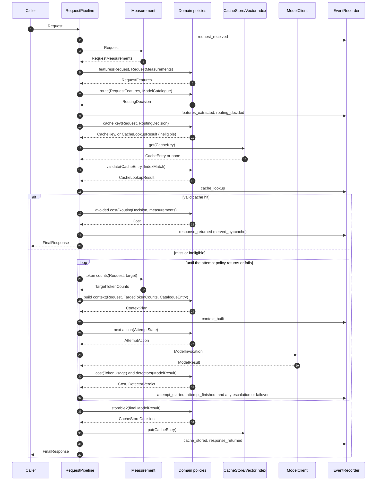
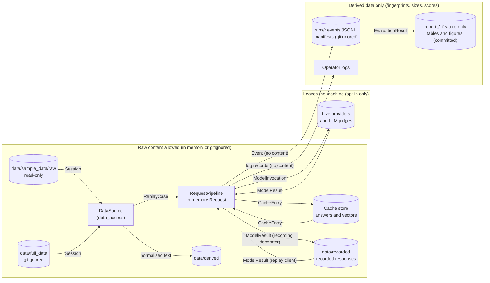

# Request Lifecycle and Data Flow (Stage 3)

Status: stage order **decided** ([ADR-0010](../adr/0010-request-pipeline-shape.md)); stage internals **provisional**. Last updated 2026-10-14.
Index: [architecture README](README.md). Components: [overview §3](overview.md#3-component-catalogue). Contract names: [overview §5](overview.md#5-provisional-contract-vocabulary).

---

## 1. Stages

The pipeline (CMP-01) runs these stages in this order for every request. Each stage is a span and emits at least one event ([observability.md](observability.md)).

| # | Stage | Measure (application) | Decide (domain) | Event(s) | Counts as overhead? | Traces |
|---|---|---|---|---|---|---|
| 0 | **Receive** | Mint `request_id` (IdSource); start the request span; read the deadline. | — | `request_received` | — | FR-REQ-02, FR-OBS-01 |
| 1 | **Measure** | Content fingerprints of each component; cheap size measures; model-based features if configured (semantic intent). | — | (inside `features_extracted`) | yes | P-1, FR-FEAT-02, FR-ROUTE-04 |
| 2 | **Features** | — | Feature extractor → `RequestFeatures` | `features_extracted` | yes | FR-FEAT-01…05 |
| 3 | **Route** | — | Eligibility filter, then routing policy → `RoutingDecision` | `routing_decided` | yes | FR-ROUTE-01…05 |
| 4 | **Cache lookup** | Exact: store lookup. Semantic (if enabled): embed, then index query. | Eligibility, key, validity, semantic match → `CacheLookupResult` | `cache_lookup` (one per tier tried) | yes | FR-XCACHE-01…07, FR-SCACHE-01…05 |
| 5 | **Context build** | Token counts per component with the target's tokenizer. | Context policy → `ContextPlan`; overflow rule | `context_built` | yes | FR-CTX-01…04 |
| 6 | **Attempt loop** | Spend-guard check; `ModelClient.invoke`; usage and cost; detector inputs (e.g. judge score). | Attempt policy → next `AttemptAction`; detectors → `DetectorVerdict` | `attempt_started`, `attempt_finished`, `retry_scheduled`, `failover_triggered`, `escalation_triggered`, `budget_blocked` | no (model time); router, judge, and verifier calls are overhead | FR-CASC-*, FR-FAIL-*, FR-ACCT-06 |
| 7 | **Store** | Store write; index write. | Store-write rules | `cache_stored` or `cache_store_skipped` | no (after the answer is known; online it can run after responding) | FR-XCACHE-04, 08 |
| 8 | **Respond** | Close spans. | Accounting totals and savings | `response_returned` | — | FR-ACCT-03…05, FR-OBS-05 |

**Why routing comes before the cache lookup** ([ADR-0010](../adr/0010-request-pipeline-shape.md)): the conservative cache key includes the target's equivalence group (FR-XCACHE-02), so the target must be known first. Routing is cheap for the current policies. An expensive router would pay its overhead even on hits; that trade-off is recorded in the ADR as a reason to revisit.

**Overhead** (QA-LAT a, ≤ 100 ms p95, provisional) is the sum of stages 1–5 plus any router, embedding, judge, or verifier measurement made in stage 6.

**Re-entry.** Two paths loop back:
- *Context overflow → re-route* (FR-CTX-04): stage 5 can return "overflow". If the configured overflow rule allows re-routing (`reroute` or `trim_then_reroute`, [context_construction.md §2](context_construction.md#2-steps)), stage 3 runs once more with a minimum-context constraint. At most one re-route per request.
- *Escalation or failover → rebuild context*: each new target gets its own stage-5 build, because tokenizers and limits differ by model.

**Terminal outcomes.** The pipeline always returns a `FinalResponse`. Expected failures (no eligible model, cap reached, all attempts failed, deadline passed) produce a response with an error status and reason, not an exception. Exceptions are for programming or configuration errors only.

---

## 2. Request lifecycle sequence

**Question answered:** in what order do components act during one request, what crosses each call, and where do the cache-hit and attempt-loop paths branch?

Simplifications in the diagram: the semantic-cache tier is drawn in [caching.md](caching.md); the spend guard, retries, and the deadline check are drawn in [attempts.md](attempts.md). The context build happens only for an attempt whose target differs from the previous build's target.

---

## 3. Replay versus online

The pipeline is the same (P-2). What changes is what the caller supplies and which adapters are injected.

| Aspect | Offline replay (current) | Online (future) |
|---|---|---|
| Caller | Replay harness (CMP-21) | Gateway (CMP-F1) |
| `Request` built from | A `ReplayCase`: logged history up to this turn, logged instructions and RAG, pairing flag (FR-REQ-03, FR-REQ-06) | The client's call |
| History | The **logged** history, including logged answers, not the candidate's own earlier answers. This simplification is recorded in every run manifest ([evaluation.md §4](evaluation.md#4-counterfactual-sources-and-their-limits)). | The client's own history |
| Unknown components | Common (e.g. a missing `rag` field is *unknown*) | Rare: the system knows its own inputs |
| ModelClient | Fake, replay (recorded or logged answers), fault-injecting; live only by opt-in | Live, with failover |
| Clock and IDs | Seeded, so runs are reproducible | System |
| `run_mode` on events | `replayed` or `simulated` | `live` |
| Timestamps | Run-time UTC, plus the naive logged timestamp as a separate field | UTC |

---

## 4. Data flow and privacy boundary

**Question answered:** where does each kind of data come from, where does it end up, and where is the boundary beyond which raw content must never travel?

| Data | May hold raw content? | Where it may live | Rule source |
|---|---|---|---|
| `Request`, `ContextPlan`, `ModelInvocation`, `ModelResult` | yes | memory only, on the request path | P-7 |
| Cache entries and vectors | yes (needed to serve); vectors are treated as content because embeddings can leak text | cache store; retention limit and invalidation (FR-XCACHE-09) | A-09 |
| Recorded responses | yes | `data/recorded/` (gitignored) | ADR-0009 §6 |
| Events, manifests, logs | **no**: keyed fingerprints, sizes, scores, IDs, versions | `runs/` (gitignored), sinks | FR-OBS-02, ADR-0015 |
| Reports | **no** | `reports/` (committed) | CLAUDE.md |
| Secrets | n/a: never in events, logs, manifests, or config hash | environment / untracked `.env` | [configuration.md](configuration.md) |

Live providers and LLM judges are the only place content leaves the machine. Both are opt-in (ADR-0003) and need a privacy review before first use (context §8).
