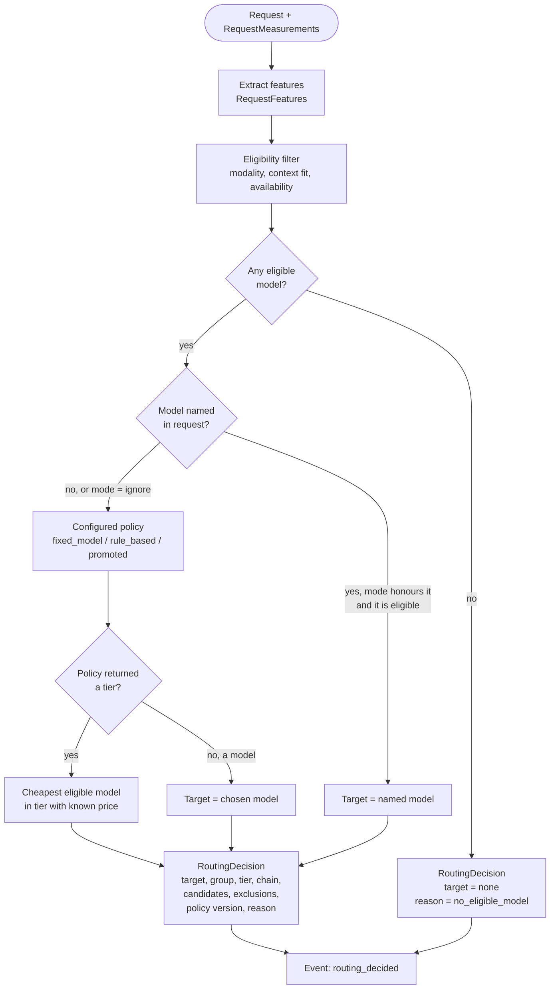

# Routing Flow (Stage 3)

Status: structure **decided**; feature set and rules **provisional**; which routing strategy wins is **open** (NG-06). Last updated 2026-10-14.
Index: [architecture README](README.md). Components: CMP-02 (measurement), CMP-04 (features), CMP-05 (routing). Requirements: FR-FEAT-*, FR-ROUTE-*.

---

## 1. Flow: features → eligibility → decision → model selection

1. **Measure** (CMP-02). Cheap measurements always: sizes and fingerprints. Model-based measurements only when configured: an embedding for an embedding-based router, or a classifier or LLM call for semantic intent (FR-FEAT-02). Each measurement records its cost and duration as **router overhead** (FR-ROUTE-04).
2. **Extract features** (CMP-04). Pure functions over the request and measurements (FR-FEAT-01). Token sizes in features are approximations labelled with their method; exact counts per target come later, in the context stage. Output: `RequestFeatures` with a feature-set version (FR-FEAT-04).
3. **Eligibility filter** (CMP-05, shared by every policy). Removes catalogue models that cannot serve the request:
   - **modality**: attachments need a model whose catalogue entry has a *verified* matching capability; unverified counts as unsupported (FR-ROUTE-05);
   - **context fit**: the estimated input size, plus a configured safety margin, must fit the model's context limit;
   - **availability**: models disabled in configuration (and, later, providers marked down by health tracking, FR-FAIL-05).

   Each exclusion is recorded with a reason. Because the filter is shared, a candidate strategy in an experiment cannot bypass capability safety.
4. **Policy decision** (CMP-05, selected by configuration, FR-ROUTE-03). The policy picks one target from the eligible set:
   - `fixed_model`: always the configured model. It implements both the premium baseline and simple deployments.
   - `rule_based`: ordered rules over features (for example, "length bucket and code presence → tier"), then the cheapest eligible model in the chosen tier.
   - Experimental policies (classifier, embedding, learned, LLM-based) live in `experiments/routing/` until promoted. A model-based router is a *measurement* in step 1 plus a pure decision here (P-1). That keeps the policy replayable.
5. **Model selection inside a tier.** When the policy names a tier, the cheapest eligible model with a known price is chosen. Ties break by catalogue order, so the result is deterministic. A model with an unknown price is chosen only if it is the only eligible one, and the decision is flagged.
6. **Explicit model requests** (FR-ROUTE-06, future, open). If the request names a model, a configured mode applies: `ignore`, `honour_if_eligible`, or `honour`. The default is `ignore` until the requirement is decided.
7. **Output** `RoutingDecision`: target, the target's **equivalence group** and **tier**, eligible candidates, exclusions with reasons, the cascade chain if one applies (from configuration, [attempts.md](attempts.md)), policy name and version, a reason code, and references to the features used (FR-ROUTE-02).

**No eligible model.** The decision has no target and reason `no_eligible_model`. The pipeline returns an error response. It never silently routes to an ineligible model.

---

## 2. Routing decision flow

**Question answered:** how does a request's features become a chosen model, and where can routing end without a model?

---

## 3. What routing does not own

| Concern | Owner | Why |
|---|---|---|
| Whether a cached answer exists | cache policy (CMP-06) | Routing runs before the lookup and does not depend on it ([ADR-0010](../adr/0010-request-pipeline-shape.md)). |
| Retries, failover, escalation | attempt policy (CMP-08) | Routing chooses the first target and the chain; the attempt policy moves along it ([ADR-0013](../adr/0013-unified-attempt-model.md)). |
| Exact token counts and context limits per attempt | context policy (CMP-07) | Exact counts need the target's tokenizer. |
| Model capabilities and prices | catalogue and price table (config) | Never inferred from labels (FR-FAIL-03, FR-ACCT-07). |

---

## 4. Evaluation hooks and the label problem

- Every `RoutingDecision` is an event, so routing mix, router overhead, and per-stratum routing are derivable (FR-OBS-05).
- The sample has no difficulty or quality labels. Routing *accuracy* therefore needs labels created later: judge-scored answers from several models on the same request, or human labels. Which proxy each approach uses is a Stage 8 plan item (FR-EVAL-04, TODO-05).
- Router overhead (latency and cost) is reported separately from answer cost (FR-ROUTE-04).

## 5. Open items

- The initial rule set for `rule_based` is configuration written in Stage 8 from the experiment plan, not here.
- The context-fit safety margin and the approximation used before exact counts are configuration (provisional).
- FR-ROUTE-06 (explicit model requests) stays open.
