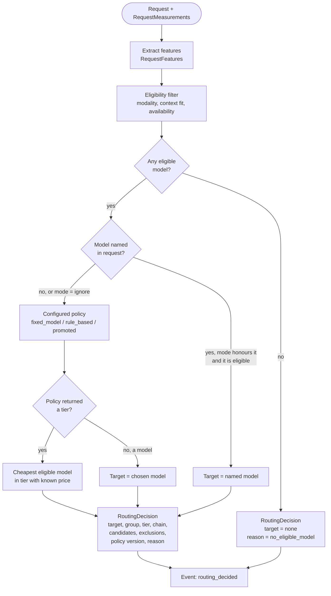
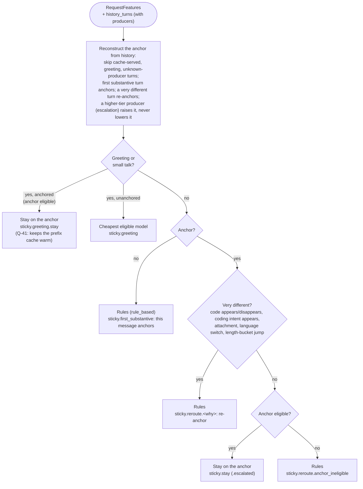
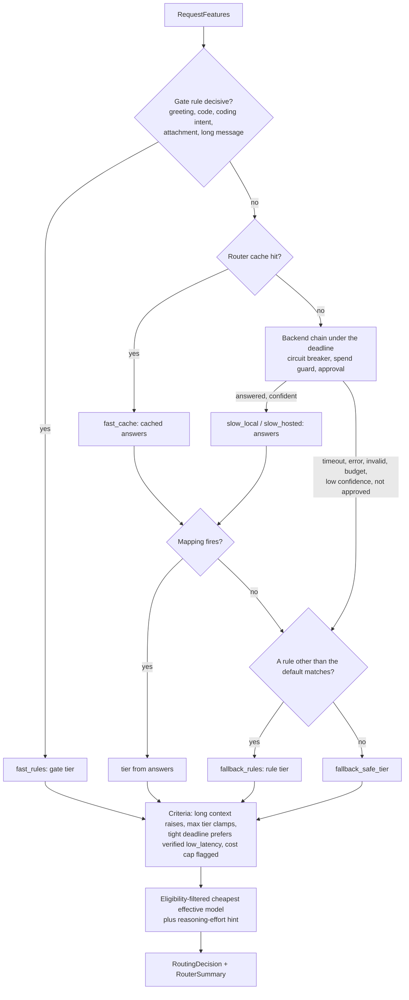

# Routing Flow (Stage 3)

Status: structure **decided**; feature set and rules **provisional**; which routing strategy wins is **open** (NG-06). Last updated 2026-10-19 (Demo milestone A: `rule_based` and `sticky` as placeholder demo components, §6; [ADR-0023](../adr/0023-demo-backend-components.md); coding intent added to the rules and the "very different" check, amendment 2, A-71).
Index: [architecture README](README.md). Components: CMP-02 (measurement), CMP-04 (features), CMP-05 (routing). Requirements: FR-FEAT-*, FR-ROUTE-*.

---

## 1. Flow: features → eligibility → decision → model selection

1. **Measure** (CMP-02). Cheap measurements always: sizes and fingerprints. Model-based measurements only when configured: an embedding for an embedding-based router, or a classifier or LLM call for semantic intent (FR-FEAT-02). Each measurement records its cost and duration as **router overhead** (FR-ROUTE-04).
2. **Extract features** (CMP-04). Pure functions over the request and measurements (FR-FEAT-01). Token sizes in features are approximations labelled with their method; exact counts per target come later, in the context stage. Output: `RequestFeatures` with a feature-set version (FR-FEAT-04).
3. **Eligibility filter** (CMP-05, shared by every policy). Removes catalogue models that cannot serve the request:
   - **modality**: attachments need a model whose catalogue entry has a *verified* matching capability; unverified counts as unsupported (FR-ROUTE-05);
   - **context fit**: the estimated input size, plus a configured safety margin, must fit the model's context limit;
   - **availability**: models disabled in configuration (and, later, providers marked down by health tracking, FR-FAIL-05).

   Each exclusion is recorded with a reason. Because the filter is shared, a candidate strategy in an experiment cannot bypass capability safety.
4. **Policy decision** (CMP-05, selected by configuration, FR-ROUTE-03). The policy picks one target from the eligible set:
   - `fixed_model`: always the configured model. It implements both the premium baseline and simple deployments.
   - `rule_based`: ordered rules over features (for example, "length bucket and code presence → tier"), then the cheapest eligible model in the chosen tier.
   - Experimental policies (classifier, embedding, learned, LLM-based) live in `experiments/routing/` until promoted. A model-based router is a *measurement* in step 1 plus a pure decision here (P-1). That keeps the policy replayable.
5. **Model selection inside a tier.** When the policy names a tier, the cheapest eligible model with a known price is chosen. Ties break by catalogue order, so the result is deterministic. A model with an unknown price is chosen only if it is the only eligible one, and the decision is flagged.
6. **Explicit model requests** (FR-ROUTE-06, future, open). If the request names a model, a configured mode applies: `ignore`, `honour_if_eligible`, or `honour`. The default is `ignore` until the requirement is decided.
7. **Output** `RoutingDecision`: target, the target's **equivalence group** and **tier**, eligible candidates, exclusions with reasons, the cascade chain if one applies (from configuration, [attempts.md](attempts.md)), policy name and version, a reason code, and references to the features used (FR-ROUTE-02).

**No eligible model.** The decision has no target and reason `no_eligible_model`. The pipeline returns an error response. It never silently routes to an ineligible model.

---

## 2. Routing decision flow

**Question answered:** how does a request's features become a chosen model, and where can routing end without a model?

---

## 3. What routing does not own

| Concern | Owner | Why |
|---|---|---|
| Whether a cached answer exists | cache policy (CMP-06) | Routing runs before the lookup and does not depend on it ([ADR-0010](../adr/0010-request-pipeline-shape.md)). |
| Retries, failover, escalation | attempt policy (CMP-08) | Routing chooses the first target and the chain; the attempt policy moves along it ([ADR-0013](../adr/0013-unified-attempt-model.md)). |
| Exact token counts and context limits per attempt | context policy (CMP-07) | Exact counts need the target's tokenizer. |
| Model capabilities and prices | catalogue and price table (config) | Never inferred from labels (FR-FAIL-03, FR-ACCT-07). |

---

## 4. Evaluation hooks and the label problem

- Every `RoutingDecision` is an event, so routing mix, router overhead, and per-stratum routing are derivable (FR-OBS-05).
- The sample has no difficulty or quality labels. Routing *accuracy* therefore needs labels created later: judge-scored answers from several models on the same request, or human labels. Which proxy each approach uses is a Stage 8 plan item (FR-EVAL-04, TODO-05).
- Router overhead (latency and cost) is reported separately from answer cost (FR-ROUTE-04).

## 5. Open items

- The initial rule set for `rule_based` is configuration; the Demo milestone's set (§6) is a placeholder, and the routing plan (R1) replaces it with evidence.
- The context-fit safety margin and the approximation used before exact counts are configuration (provisional).
- FR-ROUTE-06 (explicit model requests) stays open.

## 6. Demo components: `rule_based` and `sticky` (Demo milestone A, placeholders)

[ADR-0023](../adr/0023-demo-backend-components.md). Both are selectable by `[pipeline.routing] policy`; the default stays `fixed_model`. Configuration: `[pipeline.routing.rule_based]` and `[pipeline.routing.sticky]` in `config/defaults.toml`.

- **Features** (`domain/features/detectors.py`): language (fa, en, mixed, other, undetermined), code, length bucket, greeting / small talk, and the same for each earlier user turn with the producer of its answer (`history_turns`, from `Turn.producer`).
- **`rule_based`** (`domain/routing/rule_based.py`): the first matching rule picks a tier (placeholders: attachment, code, a coding intent (a request for code with no code in the message, A-71), a message of 400+ characters, or 8+ earlier user turns → tier 1; otherwise tier 0). Inside the tier, the eligible model with the lowest **effective** cost per answer: estimated input + assumed visible output + the model's expected **hidden reasoning** tokens (billed as output; placeholders from the live check, A-66). The nominal price would pick gpt-5-nano; with its reasoning it ranks last in tier 0. This implements routing.md §1 step 5's "cheapest in tier" with reasoning counted. The chain is the cheapest model of each higher tier.
- **`sticky`** (`domain/routing/sticky.py`), mode `sticky_v1` (owner brief §7) or `per_request`:

  A **coding intent** (the message asks for code or programming help and has no code: configured keywords with a request cue, or a word template; A-71) counts only when it **appears**: a follow-up without it ("and make it handle negatives") stays on the anchor. An anchor that already had code does not count it as new; code disappearing re-routes as before, and the rules send the intent to tier 1.

  A greeting never anchors. In an anchored session it stays on the anchor (owner decision Q-41, 2026-10-19: the provider's prefix cache stays warm, and a greeting costs almost nothing on any model); only in an unanchored session, or when the anchor is not eligible, does it go to the cheapest model.

  Escalation happens in the attempt loop along the policy's chain (ADR-0013); the next request sees the stronger producer and stays on it. The policy is stateless: nothing is kept between requests (P-8). Cost: below 0.1 ms per decision with 43 earlier turns (reports/cost).

## 7. The System-One decision router (placeholder until exp-route-013)

Decision record: [ADR-0047](../adr/0047-system-one-decision-router.md).

A decision model answers typed questions about a minimised state (no text is generated); the pure `decision_router` policy maps the answers to a tier, then to the tier's cheapest eligible model by effective cost. Infrastructure (mode, backends, deadline, cache, circuit breaker) is `[router]`; the policy is `[pipeline.routing.decision_router]`. With `router.mode = "off"` there are no answers and the policy routes by the rules, then the safe tier.

Gate, cache and backend chain run in the application cascade (R4); everything after "answers" is pure domain code.

**The cascade (R4, `application/routing/`).** With `router.mode` other than `off`, the pipeline's features stage runs `RouterCascade.decide` once per request (span `route.decide`, event `decision_measured`), puts the outcome in `RequestFeatures.decision`, and then emits `features_extracted` (feature set `fs-0.4.0-router`). In order:

1. **Gate** (`domain.routing.decision.needs_decision`): `skipped(rules_decisive)` with the rule ID; no backend is called.
2. **State** (`build_state`): the truncated message, optionally the previous user turn, derived labels. No state → `skipped(ineligible_state)`. A run is treated as dataset-derived unless its caller says it sends only SYNTHETIC or owner-written text (A-102).
3. **Router cache:** a keyed fingerprint of the state with its text folded (`[router.cache] normalisation`), plus the question set and language, looked up per chain backend under the model revision last seen from it. A hit is `answered` with `cache_hit`, zero cost, and no attempts. A backend reporting a new revision has its entries dropped, and the change is recorded and logged (ADR-0047 point 8).
4. **Backend chain** under the step budget: `router.deadline_ms`, tightened to the request's `deadline_ms` minus `reserved_pipeline_ms`. For each backend, the cascade checks, in order:
   - **time left:** with none, the step stops with `timeout`;
   - **availability:** `unavailable` if the backend can't be called now;
   - for **hosted** backends, the **approval check:** a dataset-derived state is refused (`real_data_approved`, owner: false);
   - for hosted backends, the **spend guard:** the pre-call estimate must fit the cap; an unpriced backend is allowed only with `allow_unpriced`, and the guard then stops after that call;
   - the **circuit breaker:** `circuit_open`; in the half-open state one trial call is let through.

   A call gets `min(backend timeout, time left)` plus `deadline_grace_ms`. An answer that arrives within the grace is kept and flagged `overran_deadline`. A `DecisionError`, or an answer that doesn't match the asked questions (`check_result`), is a failure counted by the breaker, and the next backend is tried.
5. **Confidence gate:** the lowest confidence the backend reported (`result_confidence`; none reported → no gate) below `min_confidence` → `failed(low_confidence)`, with the answers kept as soft signals only if configured. By default the chain does not continue (A-103); with `[router] escalate_on_low_confidence = true` the next backend is asked while time and budget remain, a low-confidence answer is never cached, and if none answers confidently the outcome stays `failed(low_confidence)`. A backend that reports no confidence is not gated, but an unknown confidence never satisfies the tier-0 rule's `tau_conf` (A-105, P-6).

The step's duration and cost are an overhead `MeasurementRecord`, summed into the response's `overhead_cost`:
- a local answer costs zero (`local_compute`);
- a hosted answer costs its own cost;
- a hosted error charges the pre-call estimate, and its cost is recorded as not computed. The router's spend guard then stops hosted router calls for the run (A-104). That guard is its own `SpendGuard` over the shared ledger, so answering calls are not stopped.

With the router off, none of this is built, and every event and response is byte-identical to the pipeline before R4 (`tests/integration/test_router_pipeline.py`, digests in `tests/fixtures/synthetic/router_off_golden.json`). Shadow use: a router may run with any routing policy. With `fixed_model` the decision is measured and recorded but changes nothing.

| Order | Condition (all thresholds are placeholders) | Tier | Reason code |
|---|---|---|---|
| gate | greeting or small talk / code or coding intent / attachment / message ≥ `long_message_chars` | 0 / 1 / 1 / 1 | `decision.gate.<rule>` |
| 1 | `complexity.score ≥ tau_complex` (2.0) or `needs_reasoning ≥ tau_reason` (0.6) | high (1) | `decision.tier1.complex` / `.needs_reasoning` |
| 2 | `cheap_model_ok ≥ tau_ok` (0.7) and complexity confidence `≥ tau_conf` (0.6) | low (0) | `decision.tier0.cheap_ok` |
| 3 | `intent ∈ high_tier_intents` (code, math_reasoning, analysis) | high (1) | `decision.tier1.intent.<intent>` |
| 4 | a rule other than the default matches | the rule's tier | `decision.fallback.rules.<rule>` |
| 5 | otherwise | `safe_tier` (1) | `decision.fallback.safe_tier` |

An unknown answer never satisfies a condition (P-6). Reasoning effort: `needs_reasoning < low_below` (0.3) → `minimal` for the models listed in `effort.models`; at or above `tau_reason` → `high_effort` (unset: the model's default).

**Sticky interplay** (`[pipeline.routing.sticky] inner = "decision_router"`): first and re-routed messages use the decision router; on an anchored, similar message a higher decided tier moves up at once, a lower one stays when the message depends on history (`depends_on_history ≥ tau_hist`) and moves down only after `downgrade_after_n` low-complexity user turns (a proxy from cheap turn features: no code, no coding intent, short), and a fallback decision never moves the session. Greetings never anchor.
