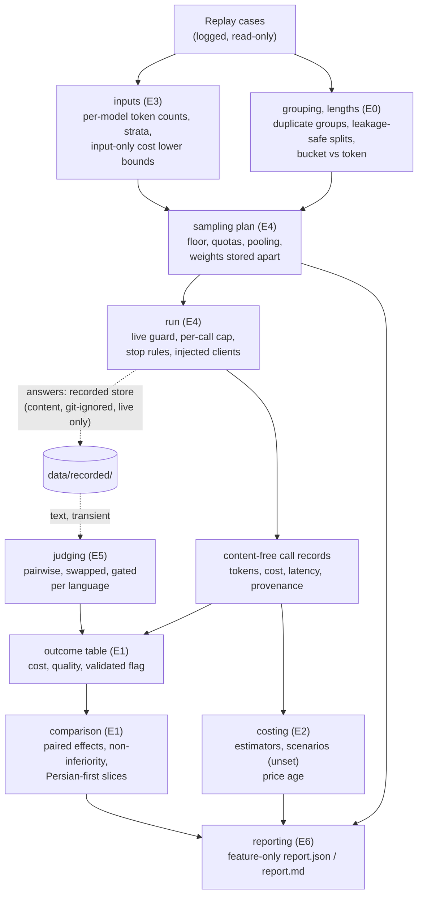

# Evaluation framework: overview

Status: **overview of the work done in Stages E0 to E6** (2026-10-30), written for readers who were not in the sessions. It summarises; the sources of truth are [evaluation_framework.md](evaluation_framework.md) (the research-backed spec), the stage notes ([e2](e2_scenario_config.md), [e4](e4_sampling_run.md), [e5](e5_judging.md), [e6](e6_logging_and_status.md)), [ADR-0025](../adr/0025-persian-folding-treatments-and-evaluation-groups.md) and [ADR-0026](../adr/0026-premium-baseline-gpt-5-5.md), and `docs/architecture/module_reference.md`.

**The one thing to remember:** all of this is **offline code tested with fake clients and a fake judge**. No live call was made, nothing has run on real data, and every threshold, quota, cap, δ, judge-gate value, scenario and maximum price age is **unset by default**. The framework measures nothing about real models yet; it is the machinery to do so honestly once the owner supplies the decisions and a budget.

---

## 1. What the framework is for

Metis-Auto routes each request to a model, builds its context, and may serve a cached answer. The evaluation framework answers: **does a routing, caching or context strategy cut cost and latency without losing answer quality, on mostly-Persian multi-turn traffic, measured fairly against baselines?**

It has to work around hard limits of the data: no token counts, prices, latency or quality labels in the logs; answers exist only for the model that was actually used; and we do not know how many output or reasoning tokens other models would have produced. So it combines (a) offline replay of logged conversations, (b) one shared sampling run that records real usage and candidate answers, and (c) a judge that is calibrated against Persian human ratings before its scores count.

## 2. What was done

| Stage | What | Where | Notes |
|---|---|---|---|
| Research and spec | Baselines, cost and output-token estimation, latency, replay, sampling, statistics, online evaluation, pitfalls, then the Persian-first requirements | [evaluation_framework.md](evaluation_framework.md) | one literature pass; unverified items are marked *[verify]* |
| Persian tokenizer measurement | Tokens per character per tokenizer on the sample | spec §2.1, `reports/cost/` | provisional (100-session sample): DeepSeek about 1.1×, MiMo about 1.6× the GPT-family count on Persian |
| `gpt-5.5` premium | New price file, disabled catalogue entry, tokenizer note | ADR-0026 | prices are a historical snapshot |
| **E0** | Persian folding treatments; duplicate groups and leakage-safe splits; bucket-versus-token report; language and length-bucket characterization tests | `domain/caching/normalise.py`, `evaluation/grouping`, `evaluation/lengths` | ADR-0025; no change to serving |
| **E1** | Baselines as assignments (fixed model, as-logged, oracle, random mix); Pareto, matched cost or quality, PGR/APGR, CPT, oracle headroom, paired effects, non-inferiority, Persian-first slicing, Holm, session-cluster bootstrap | `evaluation/comparison` | no defaults |
| **E2** | Scenario config and engine (unset gives `not_evaluated`), price-table age, output-token estimators (observed, stratified, verbosity ratio) with a paired comparison | `evaluation/costing` | [e2 note](e2_scenario_config.md) |
| **E3** | Full-prompt input token counts per model and case; input-only cost lower bounds; ranking flips versus chars/4; instruction-reuse counts; compression break-even | `evaluation/inputs`, `scripts/input_cost_report.py`, `reports/cost/` | tier handling tested at 270,000 / 270,001 / 276,480 / 276,481 |
| **E4** | Stratified sampler (floor, quotas, pooling, exact apportionment, stored weights), call plan, run estimates, live guard, per-call worst-case cap, stop rules, content-free call records, comparison tables | `evaluation/sampling`, `scripts/sampling_plan.py` | [e4 note](e4_sampling_run.md); fakes only |
| **E5** | Pairwise judging with swapped orderings, calibration export and rating import, agreement, bias diagnostics, the Persian gate, instruction-language comparison, re-simulation stub | `evaluation/judging` | [e5 note](e5_judging.md); fake judge only |
| **E6** | The comparison report and Markdown renderer; optional logging fields on the contracts; docs and a guide | `evaluation/reporting`, `docs/guides/offline_evaluation.md` | [e6 note](e6_logging_and_status.md) |
| Closing audit and fixes | Audit against the spec and ADRs; three fixes (provenance, explicit sample-conversation flag, contract wording) | see the E0–E6 section of `docs/project/progress.md` | |
| Windows fix | Spend ledger lock, path and encoding handling | separate commit | owner's work |

Size: 8 new packages (about 6,000 lines), 2 scripts, about 280 new tests, whole suite 980 passed. Delivered on branch `evaluation-framework-e0-e6` in three commits: the Windows fix, the `gpt-5.5` switch, the framework.

## 3. What was decided, and why

| Decision | Why |
|---|---|
| **Persian-first reporting.** Persian is the primary slice; English and mixed are separate; overall is labelled "dominated_by_persian" | About 91% of traffic is Persian, so "overall" is a Persian number. Pooling small slices into Persian would hide their uncertainty |
| **Nothing is set by default.** Minimum n, quotas, floors, caps, δ, gate thresholds, scenarios, maximum price age, bootstrap size: all optional, unset means `not_evaluated` or `insufficient` with a reason | We must not invent statistical guarantees or budgets. An unset value that silently became a number would make a result look supported when it is not |
| **Provenance on every number:** measured, estimated, simulated; input-only costs are lower bounds | A reader must never mistake a fake run, a local token count or a scenario for a measurement |
| **Values are withheld, not shown with a warning,** when a slice is below the minimum n | A number invites use; a reason does not |
| **Allocation is kept apart from weighting.** Minorities can be oversampled; stored weights recover population totals | Oversampling improves a minority slice's precision but must not be mistaken for its population share |
| **Quality is relative and pairwise,** judged in both orders with a tie option | A position-biased judge is neutralised by swapping; absolute scores from an unvalidated judge are not trustworthy |
| **The Persian gate:** scores are `validated` per language only if the statistic, threshold and minimum items are configured and passed; otherwise `unvalidated` and blocked from non-inferiority claims and oracle labels | The judge's Persian ability is unproven; claims must wait for human agreement |
| **Per-model tokenizers, not chars/4,** and a tier-aware price table | Persian token counts differ by up to 1.7× across models; chars/4 reorders model rankings. The long price tier changes the whole bill |
| **Teacher-forced next-turn replay is the default;** a re-simulation study is only a stub | Later turns depend on earlier answers; full re-simulation needs a Persian user simulator that does not exist |
| **One shared sampling run** serves cost calibration and quality evaluation | The same calls give real usage and candidate answers; running twice would double the cost |
| **The live guard:** a live client needs an owner approval, a cap, and (for sample data) a per-run approval; the cap is checked per call against a worst case; `uses_sample_conversations` must be stated | Live money and private data are the two real risks (ADR-0003, ADR-0018) |
| **Fake answers can never be replayed as recorded.** The recorder marks records live; the loader indexes only those | Otherwise simulated answers could be reported as measured |
| **New contract fields are optional and honest:** effort, time to first token, cache key version, entry age; descriptions say nothing populates them yet | Add the slots now, avoid implying they are filled |
| **Reuse over rebuild:** existing tokenizers, `MeasurementService`, `cost_of`, recording and replay clients, fingerprints | Fewer new places for a bug, consistent costing |
| **Standard library only** for statistics and estimators | No lockfile churn; regression models wait for real data |
| **Premium baseline `gpt-5.5`** (ADR-0026) | Owner's decision; priced by the Metis page snapshot, limits unknown |
| **Normalization is a treatment before keyed fingerprinting,** versioned by name, and never enters the production cache key without its own ADR | ADR-0015: fingerprints never normalise implicitly; changing keys changes caching behavior |

## 4. The architecture, and why it looks like this

### 4.1 Layers

The project's layer rules (ADR-0009, enforced by `tests/architecture`) apply. `evaluation` may import `application`, `domain`, `settings`, `ports` and `contracts`, **never `adapters` or `wiring`**. So:
- Models, judges and content arrive **injected** (`ModelClient`, `PairwiseJudge`, `ContentProvider`). The framework never builds a live client or reads a key.
- Everything the evaluation holds is **content-free** (IDs, counts, lengths, scores); text passes only through the content provider at judging time, or lives in the git-ignored recorded store.
- Pure functions decide (metrics, allocation, gates); only the scripts and tests do I/O.

### 4.2 Packages and data flow

| Package | Responsibility | Depends on (inside `evaluation`) |
|---|---|---|
| `grouping`, `lengths` | Keyed duplicate groups, leakage-safe splits, bucket-versus-token | none |
| `comparison` | Outcome table, estimates, baselines, metrics, bootstrap | none (the base) |
| `costing` | Usage records, price age, estimators, scenarios | `comparison` |
| `inputs` | Full-prompt counts and the input-cost report | `comparison`, `costing`, `lengths` |
| `sampling` | Sampler, run plan, guard, execution, tables | `comparison`, `costing` |
| `judging` | Pairwise judging, calibration, gate, language comparison | `comparison` |
| `reporting` | The assembled report | all of the above |

### 4.3 Why this shape

- **`comparison` is the base** and holds the vocabulary every other package speaks: `Estimate` (state, n, interval, provenance, reason), `OutcomeTable`, `sufficient()`. That is how "unset means insufficient" stays uniform.
- **Estimates carry their own explanation.** A number without a reason for its absence cannot be built (`Estimate` enforces it), which is the mechanical form of "never present a missing value as a result".
- **Injection instead of integration.** The harness can be tested completely with fakes, and a live pilot only needs someone to build clients and an invocation builder; nothing in the framework has to change for it.
- **The report is a view, not a computation.** It assembles E1 to E5 outputs; it adds no new statistics.

## 5. What remains

**Decisions for the owner (these block any meaningful run):**
1. δ (Q-13) and the judge model.
2. The gate: statistic, threshold, minimum items; the calibration size and Persian share; Persian-speaking human raters.
3. The minimum n, and the sampling allocation (dimensions, total, floor, quotas, pooling).
4. Run limits: hard cap, generation limit, stop-rule thresholds, repeat subset, vision-capable models.
5. Reasoning-length and cache scenarios (only from recorded data or a labelled sensitivity range), and a maximum price age.
6. The pilot budget and approval (Q-29, 10 USD lifetime cap under a 20 USD ceiling).
7. Re-verifying the `gpt-5.5` price, limits and reasoning capability, and the long-tier boundary (270,000 versus 276,480; whether output counts toward "context").
8. Language-classifier thresholds, length-bucket boundaries, match-key choices, and whether normalization may ever enter the production cache key (own ADR).
9. Data-owner items: caller or app id (Q-21), user quality signals, queue time, a cache verification result, and the full-dataset fields.

**Engineering still open:**
- The wiring that builds live clients and invocations for the harness. Without it a pilot cannot start.
- The live adapter applying the effort setting and measuring time to first token (streaming); the new contract fields exist but nothing fills them.
- A real judge adapter implementing the pairwise protocol (prompt, parsing, cost).
- `BaselineSpec` wired to `baselines.toml`; mapping the report into `EvaluationResult`; wiring the scenario and price-age checks into `scripts/run_experiment.py`.
- Re-checking every *[verify]* item (AIQ definition, RouteLLM's APGR grid, provider cache terms, leaderboard figures).
- A Mac test run of the Windows commit.

**Then the real work:** a small pilot, the Persian human calibration, fitting the output-token estimators on real usage, and only then a decision-grade comparison.

## 6. How it could be better

Listed roughly by value; none is committed work.

1. **Run a pilot early and small.** Every scenario and estimator is currently unfitted. Real reasoning-token usage on Persian requests is the biggest uncertainty and decides the budget.
2. **Rename the estimate `state` value `measured` to `computed`.** Today a simulated value has `state: "measured"` and `provenance: "simulated"` in the JSON. The Markdown prints the provenance, but a machine reader can misread it.
3. **Close the ADR-0006 report gaps:** per-row token-count fidelity, overhead latency, and judge agreement in the report.
4. **Write the missing ADRs:** one for the provenance rule (recorder marker, loader skip) and one for the explicit-approval and no-defaults rules; today they live only in stage notes.
5. **Plan statistical power.** Add a function that, from a pilot's variance, says how many requests per slice are needed for a given interval width, instead of leaving the sample size as a bare number.
6. **Cluster-aware sampling.** Units are replay cases, so turns of one session can both be drawn; weights treat them as independent. Sampling by session, or a design-effect correction, would be more honest.
7. **Better judge statistics.** Bradley-Terry or similar over pairwise results, agreement per rater, and tooling for the human rating sheet.
8. **A real Persian user simulator** for the re-simulation study, to measure the teacher-forcing bias instead of assuming it small.
9. **Regression estimators for output length,** with the stratified quantile and verbosity ratio as baselines they must beat, once recorded usage exists.
10. **A cache experiment** with repeat prefixes at realistic spacing to replace the cache scenarios' placeholders with a measured share.
11. **Continuous checks:** a CI job that runs the full suite and ruff on Windows and macOS; a test that every report number carries a provenance label; a check that no report contains a hash or text.
12. **Concurrency test for the ledger,** especially the Windows branch.

## 7. What this is not evidence for

- No claim here is about real model quality, real cost savings or real latency.
- The sample-derived numbers (tokenizer gaps, instruction reuse, input sizes) come from 100 sessions and are provisional (ADR-0008).
- Costs in the reports are lower bounds or scenarios; "measured" applies only to live or recorded runs, and there are none.
- A validated judge, in this framework, means "passed the configured agreement gate against human ratings", not "correct".

## 8. Where things are

| Need | File |
|---|---|
| The spec (research, baselines, metrics, sampling, pitfalls, Persian-first rules) | [evaluation_framework.md](evaluation_framework.md) |
| Status, logging fields, spec §9 mapping | [e6_logging_and_status.md](e6_logging_and_status.md) |
| How to run the pieces, and the owner-run live steps | [../guides/offline_evaluation.md](../guides/offline_evaluation.md) |
| Module-by-module reference | `docs/architecture/module_reference.md` |
| Decisions | [ADR-0025](../adr/0025-persian-folding-treatments-and-evaluation-groups.md), [ADR-0026](../adr/0026-premium-baseline-gpt-5-5.md) |
| Progress log | `docs/project/progress.md` |
