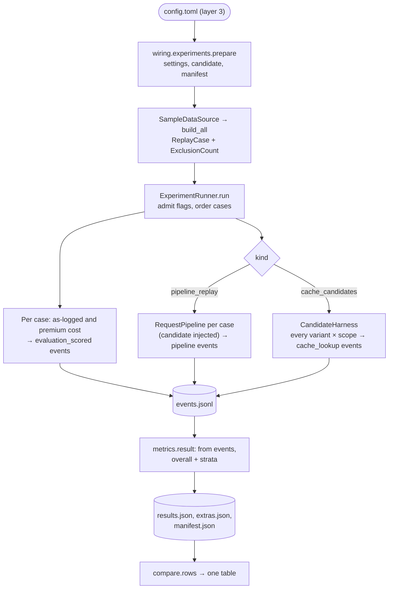

# Experiment framework (Stage 8)

Status: **decided** (config shape, EXP-ID naming, runner kinds, candidate loading, run files, comparison format; [ADR-0022](../adr/0022-experiment-runner-and-run-tracking.md)); metric coverage **provisional** (judge scores and agreement need a judge and a Persian-capable embedder, not built). Last updated 2026-10-18.
Architecture: [evaluation.md](../architecture/evaluation.md) (flow, replay rules, counterfactual sources, baselines). Code: `evaluation/runner`, `evaluation/cache_candidates`, `evaluation/metrics`, `evaluation/baselines`, `wiring/experiments.py`, `scripts/run_experiment.py`. Plans: [caching](caching_plan.md), [routing](routing_plan.md), [context](context_plan.md).

This document answers: **how does an experiment declare what it tests, how is a run recorded, and how do results from different strategies end up side by side?**

---

## 1. What an experiment declares

One TOML file per experiment, `experiments/<area>/<EXP-ID>-<slug>/config.toml`, loaded as **configuration layer 3** ([ADR-0019](../adr/0019-configuration-format-layers-and-secrets.md)). It overrides the defaults and may not set `live`, `budget`, `paths`, or `dev` (the runtime decides what a machine allows). Validated by `settings.ExperimentSettings` (unknown keys are errors).

| Key | Meaning | Example |
|---|---|---|
| `[experiment] id` | EXP-ID (§2); required by the runner | `"exp-cache-001"` |
| `name` | slug | `"exact-cache-baseline"` |
| `kind` | runner kind (§3): `pipeline_replay` or `cache_candidates` | |
| `counterfactual_source` | where answers come from ([ADR-0014](../adr/0014-counterfactual-answers-via-model-client.md)): `fake`, `logged_match`, `recorded`, `proxy`; `live` is refused in Stage 8 | `"logged_match"` |
| `seed` | recorded in the manifest; used by any randomised strategy | `0` |
| `hypotheses` | `H-n` IDs tested ([context.md §5.2](../project/context.md)) | `["H-3"]` |
| `baselines` | must include `as_logged` (ADR-0002); `premium` is the brief §5 estimate | `["as_logged", "premium"]` |
| `metrics` | metrics the plan relies on; each appears in the result, measured or with the reason it isn't (`not_produced_by_runner`) | |
| `prompt_composition` | the assumed prompt composition ID (context_construction.md §4), in the manifest | `"logged_full"` |
| `[experiment.data]` | the data slice: `dataset` (`sample_v1`), `missing_key` (`absent`, the default since Q-37, or `unknown`; A-61), admitted `pairing_flags`, `ordering` (`logged_time` / `session_order`), `max_sessions` | |
| `[experiment.strategy]` | the candidate under test: `slot` (§4), then `builtin` **or** `file` + `object`; `version`; `[experiment.strategy.params]` (opaque here, validated by the strategy) | |
| `[pipeline.*]`, `[model_options.*]` | for `pipeline_replay`: the pipeline configuration the candidate runs with (promoted components only) | |

Per-run overrides go through the explicit override layer: `scripts/run_experiment.py <config> --set experiment.data.missing_key=unknown`. The override is part of the config hash in the manifest, so the two runs stay distinguishable.

## 2. EXP-ID naming

`exp-<area>-<nnn>`, lower case (the contracts' `Name` type; a regex in `settings`):

| Area code | Folder | For |
|---|---|---|
| `cache` | `experiments/caching/` | exact, semantic, curated cache |
| `route` | `experiments/routing/` | routing strategies, cascades, sticky routing |
| `ctx` | `experiments/context/` | context reduction |
| `cost` | `experiments/cost/` | tokenizer and price sensitivity |
| `eval` | `experiments/evaluation/` | judge calibration, metric validation |

Numbers are assigned in order; `9nn` is reserved for tests. A run ID is `<EXP-ID>-<UTC stamp>-<6 hex>`. Files: `runs/<EXP-ID>/<run-id>/` (git-ignored); committed summaries in `reports/<area>/<EXP-ID>/`.

## 3. Runner kinds

Both write the same files and the same `EvaluationResult` shape, computed from the run's events ([ADR-0012](../adr/0012-event-stream-as-measurement-record.md)).



- **`pipeline_replay`**: each admitted case goes through the real `RequestPipeline` ([P-2](../architecture/overview.md)) with the declared counterfactual client. A routing or context candidate is injected in place of the configured promoted component. Metrics: coverage, total and per-request cost, savings against each baseline, served-from-cache rate with hit correctness (unmeasured), overhead p50 and p95, and model latency (unmeasured offline).
- **`cache_candidates`**: the `CandidateHarness` evaluates **every key variant and every scope in one pass**, outside the serving path ([caching.md §4](../architecture/caching.md#4-measurement-and-accounting)). Metrics per variant and scope: candidate hit rate (Wilson 95 % interval), hit correctness (unmeasured until a quality signal exists), and the as-logged cost of the hit cases (an upper bound on what the hits could save). Extras: an eligibility and hit table per variant, lexical repeat groups, and a lexical answer-match signal.

Both runners also report: coverage, the as-logged baseline (total and per request, with n and worst fidelity), and the premium estimate. Exclusions (`no_preceding_user`, non-admitted flags) are listed in the result (FR-EVAL-08).

## 4. Adding a strategy: one interface and one config entry

| Slot (`[experiment.strategy] slot`) | Interface to implement | Injected into | Example |
|---|---|---|---|
| `routing_policy` | `domain.routing.base.RoutingPolicy` (`ref`, `choose(features, eligible)`); constructed as `object(params)` | the candidate pipeline, in place of `[pipeline.routing]` | `tests/integration/test_experiments.py` (`FirstEligible`) |
| `context_strategy` | `domain.context.ContextStrategy`; constructed as `object(params)` | the candidate pipeline | (none yet) |
| `candidate_index` | `evaluation.cache_candidates.CandidateIndex` (`lookup(item, session_ref)`, `add(item)`); a factory `object(variant, params)` | the harness, one index per variant | built-in `exact` (EXP-CACHE-001) |

**Loading** ([ADR-0022](../adr/0022-experiment-runner-and-run-tracking.md) point 5): `file` is relative to the config's folder and must resolve under `<repo>/experiments/`. `wiring.experiments.load_candidate` imports it with `importlib` under a private module name. `settings` refuses `experiment.strategy` in every layer except an experiment file, so `config/defaults.toml` and `config/local.toml` can never load unpromoted code (repository_structure §6.2). The candidate's name and version go into `Versions.policies` (`candidate:<file>.<object>`) on every event and in the manifest.

A model-based candidate (embedding router, LLM router) must respect P-1: its port calls are *measurements*. In an experiment it may hold a port it was given by its own factory, but to be promoted it must be split into a measurement (`application`) and a pure decision (`domain`) (ADR-0009 amendment 1).

## 5. Running and run records

```sh
.venv/bin/python scripts/run_experiment.py experiments/caching/exp-cache-001-exact-baseline/config.toml \
    [--set experiment.data.missing_key=unknown] [--report-dir reports/caching/exp-cache-001]
```

| File (`runs/<EXP-ID>/<run-id>/`) | Content (all content-free; tested) |
|---|---|
| `manifest.json` | `RunManifest`: run and experiment IDs, start time, code (git commit and dirty flag), dataset and data hash (sha256 of the file read), seed, `Versions` (config hash, fingerprint key ID, catalogue, prices, policies, candidate), counterfactual source, composition assumption, history mode (`logged_history`, A-30), ordering rule, admitted flags, live flag, hardware |
| `events.jsonl` | every event: `run_started`, per-case `evaluation_scored` baseline costs, the kind's own events, `run_finished` with exclusions |
| `results.json` | `EvaluationResult`, computed from the events |
| `extras.json` | counts that are not metrics: pairing flags, label resolution, and per runner kind (variant table, repeat groups, lexical signal) |

**Reproducibility.** Same config, code, data, and fingerprint key → the same events and results (sequential IDs within a run, deterministic ordering), apart from the run ID (random suffix), timestamps, and durations. Without `METIS_FINGERPRINT_KEY`, each run uses a random key (A-44): every count reproduces, but fingerprints, case IDs, and strata IDs differ between runs. Set the shared key before comparing anything keyed (Q-20).

## 6. Comparison format

`evaluation.runner.compare.rows(...)` → **one row per run × key variant × scope × baseline, one column per metric**, for one stratum (overall by default). A cell is `value (n=…, low–high)` or `state: reason`; "not computed" never shows as zero. Each row carries what decides comparability: source, composition assumption, data hash, config hash, fingerprint key ID. Two rows are comparable only if their data hash and composition match (and their key IDs, for anything keyed). Example: [reports/caching/exp-cache-001/](../../reports/caching/exp-cache-001/README.md).

## 7. Evaluation harness components

| Component | Where | Notes |
|---|---|---|
| Replay over sessions, honouring pairing caveats | `data_access` (loader, case builder), `evaluation.runner.admit`, `order_cases` | Flags `clean`, `multiple_answers`, `skipped_consecutive_user`, `unanswered` (new in Stage 8: a user message the log never answered); `no_preceding_user` answers are exclusions. No look-ahead; logged history (A-30). Order: naive logged time (A-31) or session order. |
| Baselines | `evaluation.baselines` | As-logged (label mapping → catalogue model → counted and priced; "not computed" otherwise); premium (brief §5 estimate). |
| Metrics | `evaluation.metrics` | From events; strata now: opaque category and turn depth (first user turn or later). Language, length, and component-presence strata wait for the language detector (FR-FEAT, plan item). |
| Judges | `ports.Judge`, `adapters.judges.fake` | Pluggable and versioned. No real judge yet. An LLM judge is a live call: opt-in, under the budget, with owner approval for sample content (ADR-0018). Its input contract is O-6. |
| Counterfactual answers | `adapters.providers.replay` | `logged_match` (logged answer only for the mapped model), `recorded` (from `data/recorded/`, keyed by model + exact input), `fake`, `proxy`. Coverage is reported by every run; quality is computed only over covered cases. |
| Agreement | not built | Needs a Persian-capable embedder chosen by the caching plan's stage C2 measurements (ADR-0006 point 1a). |

## 8. Open items

- Judge and agreement metrics; language strata (routing and caching plans).
- Live experiment runs (each needs the owner's approval, an estimate, and the privacy review for sample content; ADR-0018).
- Event volume on the full dataset (ADR-0022 consequences).
- `synthetic_v1` and the full dataset as `experiment.data.dataset` values (Stage 9).
