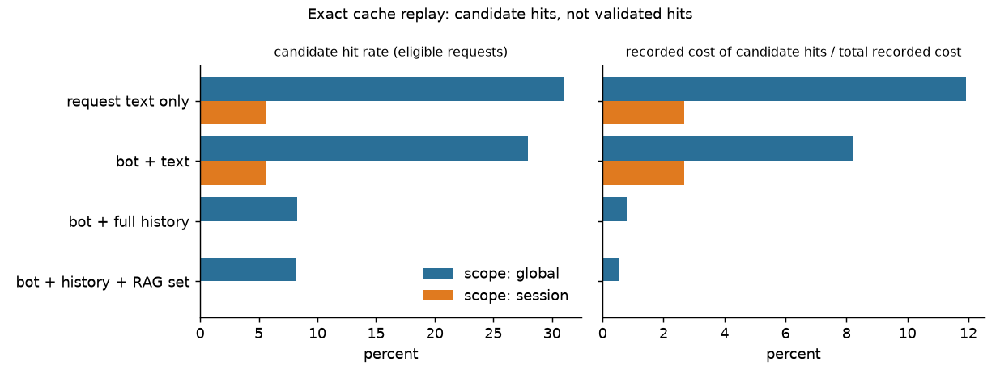
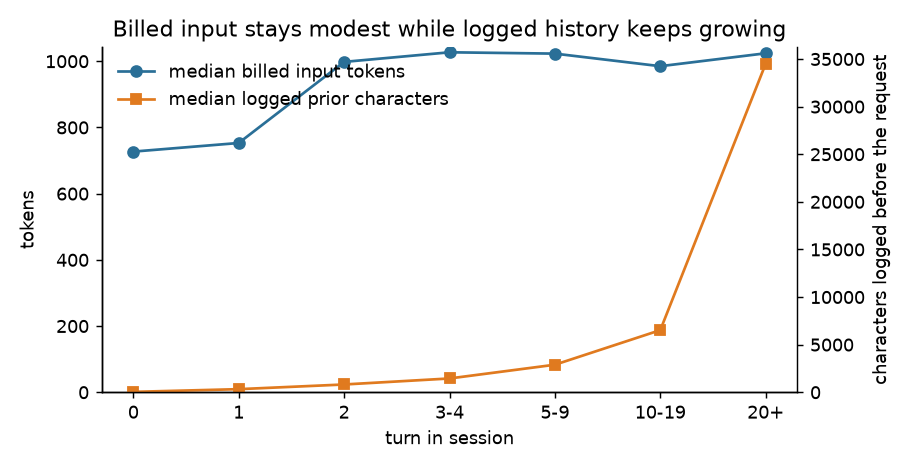
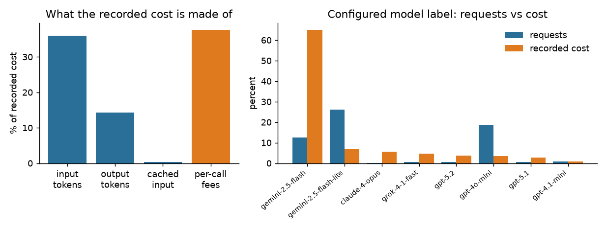

# Metis full-dataset EDA: short report

Dataset `poriniki/metis`, revision `30f578f283b903cdbd06cd1b5f7f962f76452ded` (pinned). Run date 2026-10-30. Status: **draft for review**. Every number below is rendered from [`claims_ledger.csv`](../../reports/full_eda/tables/claims_ledger.csv) and checked by `scripts/full_eda_render.py --check`. No message content, instructions or retrieved text appears here. Evidence classes: *observed* (read from the export), *metadata-derived*, *heuristic label*, *hypothetical reconstruction*, *simulation*. Detail: [`eda_findings.md`](eda_findings.md), [`experiment_plan.md`](experiment_plan.md), [`metis_questions.md`](metis_questions.md).

## 1. Bottom line

- **The export is small in tenants and very concentrated.** 80,179 sessions, 710,640 messages, 349,079 candidate request-response pairs, but the 5 largest `user_id`s produce 97.0% of requests and the top 1% of users 91.4% of recorded cost. Findings describe this export, not production.
- **Per-call fees are a larger cost block than any token lever.** 37.6% of recorded cost is per-call charges (modal amount 0.002 units), which track logged RAG queries (correlation 0.99). Input tokens are 36.0% and output 14.3%. Token reduction and routing cannot touch the fee block.
- **Exact caching is safe only in narrow forms.** With a key that includes bot, text and full history, 8.3% of eligible requests are *candidate* hits, all across sessions, covering 0.8% of recorded cost. Within one session the key never repeats. A bot-plus-text key reaches 28.0% but ignores history.
- **Logged history is not fully resent, and one model label carries the cost.** Median logged prior text at turn 20+ is 34,506 characters, yet median billed input is 1,024 tokens. The label `gemini-2.5-flash` is 12.5% of requests and 65.0% of recorded cost.
- **Quality cannot be established from this data.** No quality labels, no alternative-model outputs, no latency, no failure log. Routing, cascade and reduction savings below are simulations or structural sizing, not quality-preserving savings.

## 2. Data and representativeness

**Analysed:** all 80,179 sessions in the pinned revision (the team's "about 100k" is not borne out; the dataset card agrees with the count), 710,640 messages (355,965 USER, 349,079 AI, 5,453 SYSTEM, 143 TOOL), 1,830 bot configurations (675 used) and 133 user IDs in sessions. Message timestamps run 2026-03 to 2026-10; session `created_at` starts 2024-10, and 0.9% of sessions were created before the first message month (naive timestamps, timezone unknown, Q-06). `dialogue_length` matches observed messages for 100% of sessions; there are 0 duplicate message IDs and 2 null timestamps.

**Pairing is heuristic.** There is no call ID, so each AI message is paired with the preceding USER message: 94.9% clean, 2.6% with no preceding USER, 2.0% after consecutive USER messages, 0.4% after another AI message. 5.0% of USER messages have no AI answer.

**Differences from the sample.** The sample was four opaque categories of 25 sessions and 100 sessions in all; the export has no category field, relational tables instead of nested JSON, a `bot` table that holds model, provider and instructions, billing records with token counts and cost, and user IDs. Persian share of USER messages is 76.8% here against about nine in ten in the sample. Categories as strata are not available; bots and configured model labels are used instead (NG-08).

**What generalizes.** Conclusions hold for this export. Traffic is dominated by a few tenants and bots (69.3% of requests from 10 bots), the dataset license limits use to educational purposes and forbids redistribution (committed outputs here are aggregates only), and no sampling probabilities are known, so no traffic weighting is applied.

## 3. What the fields mean and how sure we are

- **`model` is a bot setting, not a per-message log.** Provider and model live on the bot record, a single current snapshot (94.7% of used bots were edited after creation). Whether a user or Metis chose it, and which model served each message, is unverified (see questions). 29.7% of requests belong to `workflow`/`default` bots, which carry no token billing (100.0% of them have an empty billing list).
- **`instructions` are bot configuration**, present as text on 614 used bots in 501 distinct normalised texts; the stored text may postdate a given request. At turn 0 billed input rises about 0.33 (English-labelled) and 0.32 (Persian-labelled) tokens per instruction character, with R² 0.98 for the Persian-labelled fit, so the text is very probably sent in full. Status: *partially verified*; the stored text may still postdate a request.
- **Billing is the best token evidence**: 70.2% of AI messages carry billing items, with 1,191.6 million input tokens and 72.6 million output tokens recorded. For 5 models cached tokens are reported outside `inputTokens`; I add them back. Recorded costs follow their own unit rates, which differ from the 2026-10-18 price file (see the implied-rate table), so as-logged cost and repriced cost are never mixed.
- **`rag`**: 18.2% of AI messages log at least one chunk; 86.9% of RAG-configured requests do, and 6.1% of non-configured ones also do. Billed input at turn 0 rises 0.34 tokens per chunk character (R² 0.95), so retrieved chunks are sent in full. Chunk lengths cap near 2,500 characters; the sample's 4,019 plateau is not a per-request cap here (per-request context median 7,440 characters, p99 45,085).
- **`input`** objects appear on 20.2% of AI messages and hold form-widget definitions (name, type, label, choices), a bot-side configuration; user widget use is not observable.
- **History**: logged history is complete, but what reaches the provider is unknown. Billed input grows only modestly with turn, so history is windowed, summarised or both. A rough decomposition of billed input (turn-0 fits applied to all single-call requests; *hypothetical*) attributes 22.4% to instructions, 35.8% to retrieved chunks, 1.1% to the current message and 40.8% to the rest (history, memory, summaries, formatting, fit error).

## 4. Findings by lever

### 4.1 Exact response cache (simulation, candidate hits)

Replay is chronological with answer-completion times taken from the logged AI timestamp, no future answers, and 93.5% of AI messages eligible after excluding missing text, non-STOP finishes, attachments, tool calls and moderation actions. Duplicate-occurrence counts, the n−1 upper bound and realistic candidate hits are different quantities: for bot plus text across all users, 91,309 requests are reusable in the cold-cache upper bound, which comes from 56,405,171 pairs.

| Key (scope) | Candidate hits / eligible | Recorded cost of hits / total |
|---|---|---|
| request text only (all users) | 31.0% | 11.9% |
| bot + text (all users; bots belong to one user) | 28.0% | 8.2% |
| bot + text (same session) | 5.6% | 2.7% |
| bot + full history (cross-session) | 8.3% | 0.8% |
| bot + full history + RAG set | 8.2% | 0.5% |

Cross-user reuse is unmeasurable: every bot belongs to one `user_id`, so shared scope across tenants has no data. Median gap between the first answer and a later bot-plus-text candidate hit is 965 hours, so short TTLs lose much of the opportunity. 14.4% of candidate hits are at turn 0. **Unproven:** hit correctness, freshness, personalisation. Cost shown is the as-logged cost of avoided calls, before lookup and storage overhead.

### 4.2 Semantic response cache (heuristic; embeddings not run)

A seeded lexical screen over 40,366 distinct first-turn requests found 3,002 same-bot candidate pairs (estimated word-bigram Jaccard at least 0.8), so 1.2% of sampled requests have a near-duplicate partner beyond exact matches. This is a floor for lexical similarity only. No Persian-capable embedding model was run; precision, recall and incorrect-hit rate are **pending** a labelled review set (exported, unlabelled). Similarity is not correctness.

### 4.3 Context reduction (structural sizing; quality unverified)

- **History/memory:** relative to each bot's own turn-0 median, billed input is 1.36x at turns 3-4 and 1.71x at turn 20+. Input above the turn-0 level is 67.2% of billed input in single-call, no-RAG requests, an upper-bound proxy for history, memory and summary tokens. Windowing already exists in some form; further trimming needs a quality test.
- **Input mass is concentrated:** requests over 8,000 input tokens are 10.7% of requests but 65.2% of input tokens.
- **RAG:** 33.3% of chunk rows duplicate another chunk in the same message, and 61.2% repeat a chunk already supplied earlier in the session. Those are candidate removals, not proven redundancy.
- **Instructions** are about 22.4% of billed input (hypothetical); the 10 largest instruction groups cover 75.1% of requests and the median instruction is 1,173 characters. Provider caching already covers 7.0% of effective input overall and 16.5% where instructions exceed 1,500 characters; Gemini rows record no cached tokens, which is a data gap, not proof of no caching.

### 4.4 Routing, cascade, failover (simulation; no quality evidence)

Configured model labels: 59 labels across 11 providers. A transparent rule ("short, no RAG, no attachments, no tools, no JSON") matches 72.6% of billed requests, 21.7% of recorded cost, and 46.5% of those already run on the cheapest high-volume model. A same-basis simulation (recorded rates of that model, never routing upward, per-call fees excluded) gives a hypothetical upper-bound saving of 14.2% of recorded cost for the rule group and 41.6% for all billed requests, assuming acceptable quality, which is unverified. Historical model choice is bot configuration, not an optimal-routing label. Escalation signals available in the data are thin: 0.4% of answers end with `LENGTH`, and 0.5% are JSON-like structured outputs. No failure, retry or fallback events exist.

## 5. Prior-signal check

| ID | Sample claim | Full-data result | Verdict |
|---|---|---|---|
| F-1 | short, right-skewed prompts | median 27 chars, p90 131, p99 1,001 | confirmed |
| F-2 | about 91% Persian | 76.8% of requests (heuristic) | partly: Persian majority, lower share |
| F-3 | instructions large, reused | median 1,173 chars; 501 groups for 614 bots; top 10 groups 75.1% of requests | confirmed; they are bot config |
| F-4 | instructions 82.6% of hypothetical prompt | instructions about 22.4% of billed input, RAG 35.8% (hypothetical decomposition) | refuted for billed input |
| F-5 | RAG plateau at 4,019 chars | chunk cap about 2,500; request context median 7,440 | not reproduced |
| F-6 | repeat groups cover 16.3% of messages | 36.9% of USER texts repeat | confirmed, higher (short texts) |
| F-7 | no safe cache pairs | session scope 0.0%; cross-session 8.3% | partly |
| F-8 | 7.5% repeated answers | 36.0% | confirmed, higher |
| F-9 | median 2 s gap | median 1.8 s, p90 7.0 s (not latency) | confirmed |
| H-1 | instructions/prefix the largest lever | instructions 22.4% of input, RAG 35.8%, fees 37.6% of cost | partly: major, not largest |
| H-2 | history trimming cuts input | excess over turn 0 is 67.2% of input | supported structurally; quality untested |
| H-3 | full-key exact cache small but safe | 8.3% eligible, 0.8% of cost | supported as small; validity untested |
| H-4 | semantic beats lexical | lexical floor 1.2%; embeddings not run | inconclusive |
| H-5 | cheap features route | no quality labels | not measurable |
| H-6 | cascade beats single model | no quality signal or failure log | not measurable |
| H-7 | chars/4 misestimates tokens | about 3.2 (fa) and 3.0 (en) chars per token, slope-based | supported directionally |
| H-8 | curated first-turn cache | top 100 keys cover 16.1% of first-turn requests; 23.0% repeat | inconclusive; no traffic-source label |

## 6. Decision table

| Lever | Evidence | Eligibility | Expected benefit | Failure modes | Priority | Next validation |
|---|---|---|---|---|---|---|
| Exact cache, full key, session or tenant scope | simulation | 93.5% of requests eligible | small: 0.8% of cost | stale or personalised answers | now, narrow | hit-correctness review |
| Semantic cache | heuristic | first-turn, same bot | unknown | wrong reuse | later | labelled pairs, embeddings |
| History/RAG reduction | structural | multi-turn, RAG bots | large input share, unquantified | lost facts | small experiment | fixed-model A/B with judge |
| RAG query fees | observed | RAG-configured bots | up to 37.6% of cost is fees | stale retrieval | small experiment | count and cache retrieval queries |
| Routing | simulation | rule group 72.6% | upper bound 14.2% | quality loss | needs data | benchmark with judge |
| Cascade, failover | none | all | unknown | latency, double cost | needs data | failure/retry logging |

**Can implement now:** exact cache with the full key (behind a flag), per-call-fee and cache-hit logging, input-composition fingerprints. **Small experiment:** retrieval-query caching, history windows, RAG dedupe, semantic pairs review. **Needs data:** routing, cascade, failover, cross-user caching.

**Sequence:** (1) log call IDs, per-call fees, cached tokens and the served model; (2) measure hit correctness on a labelled pair set; (3) test RAG query caching and chunk dedupe; (4) history-window A/B; (5) only then routing benchmarks.

## 7. Blockers and data requests

- No quality evidence, no alternative-model outputs, no latency or failure logs, no traffic-source label, and one user per bot (no cross-tenant cache evidence).
- Top requests to Metis: whether `model` is user-selected; the exact prompt composition and history policy; `inputTokens`/`cachedInputTokens` semantics per provider; what the per-call fee covers; Gemini caching; per-message served model; timezone (Q-06). Full list in [`metis_questions.md`](metis_questions.md).
- Hygiene: the execution prompt contained a literal Hugging Face token. It should be rotated. Embedding-based semantic analysis was not run (no local embedding model installed).
