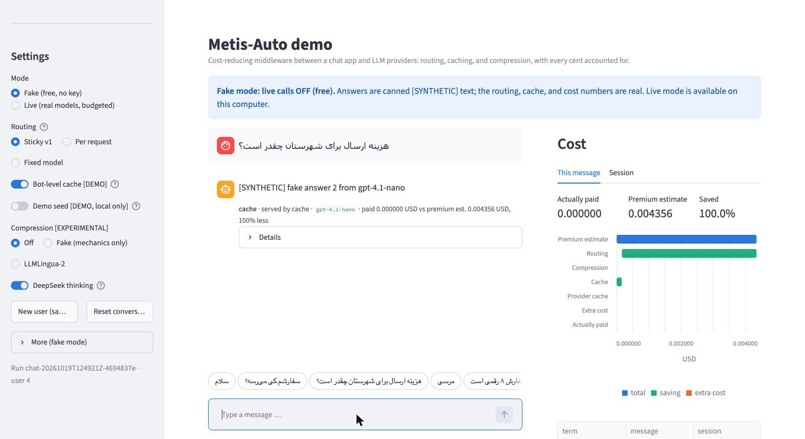

# Demo quickstart (for teammates)

A step-by-step guide to running the Metis-Auto demo on your own computer, written for someone new to the project. It takes about 15 minutes. You need no API key to start: the free fake mode works out of the box.

> **Status (2026-10-19, Demo B).** The demo is complete: a **browser UI** (Streamlit, §7) over the same backend as the **terminal chat** (`scripts/chat.py`, §7.6), in free fake mode and real-model mode: rule-based and sticky routing across the five test models, the demo cache settings (bot-level scope, the demo seed), experimental LLMLingua-2 compression, DeepSeek thinking on/off, SYNTHETIC bot presets, and the cost panel. This guide is a required deliverable of the Demo milestone ([progress](../project/progress.md), [owner brief](../project/live_testing_and_demo_brief.md) §10, §12). Everything shown in the demo is a **placeholder**: the routing rules, thresholds, and demo cache settings show the mechanism, not a measured saving ([ADR-0023](../adr/0023-demo-backend-components.md), [ADR-0024](../adr/0024-demo-ui-streamlit.md)).

Deeper background, if you want it: [local development guide](local_development.md) (setup, configuration, Docker), [configuration.md](../architecture/configuration.md) (all the layers), [ADR-0018](../adr/0018-live-calls-for-development-under-a-lifetime-budget.md) (the budget).

---

## 1. What the demo is and what it shows

Metis-Auto is **cost-reducing middleware** between a chat application and LLM providers. For each message it decides how to answer it as cheaply as possible without hurting quality, and it shows where the money went. The demo is a chat window in your browser (or, more bare-bones, in the terminal) over the real Metis-Auto pipeline that makes those decisions visible:

| Feature | What you see |
|---|---|
| **Routing** | Which model answered and **why**. *Sticky routing* (the default in the chat): a greeting never anchors (before the first real question it goes to the cheapest model; afterwards it stays on the anchor); the first real question **anchors** the conversation on a model chosen by simple rules (code, a request for code, long messages, deep conversations → a stronger tier); similar follow-ups **stay** on it; a very different message (code appears, a request for code appears, a language switch, a much longer message) is **re-routed**; a poor answer is **escalated** to a stronger model, which then becomes the anchor. *Per-request* mode applies the rules to every message; *fixed* mode uses one model. Models: `gpt-5-nano`, `gpt-4.1-nano`, `gpt-4o-mini`, `deepseek-v4-flash`, `mimo-v2.5`. Costs are compared **including hidden "reasoning" tokens**, which is why `gpt-5-nano` is rarely chosen despite its low price. |
| **Caching** | Repeat a question and it is answered from Metis-Auto's own cache: `served_by: cache`, no model call, cost about 0. *Bot-level scope* (a DEMO setting) shares answers between different users of the same bot; the *demo seed* answers a few sample questions from logged answers, locally. Providers' own prompt caches also show up, as cached input tokens and a "provider cache saving". |
| **Compression** (EXPERIMENTAL) | LLMLingua-2 shortens long history and retrieved documents (never the bot's instructions) before sending them; the saving and the time it takes are shown separately. Its quality, especially in Persian, is not yet measured. |
| **Cost panel** | Always visible beside the chat, for the last message and the whole session: what was paid, what a premium model (`gpt-5.5`) would have cost (an estimate, never a call), the % saved, a chart of the savings by category, and how much of the budget is used; tokens, models, and Metis-Auto's own overhead under each answer. §7.4 explains how to read it. |

All conversations in the demo must use **your own or synthetic messages**, never real user data (ADR-0018).

## 2. Setup from a fresh clone

You need **Python 3.13**, a real installation rather than conda's. On macOS with Homebrew: `brew install python@3.13`. On other systems, any non-conda Python 3.13 works.

```sh
git clone <repo-url> metis-auto
cd metis-auto

# 1. A virtual environment from Python 3.13 (not conda)
/opt/homebrew/bin/python3.13 -m venv .venv      # or: python3.13 -m venv .venv

# 2. Install the exact, hash-checked versions from the lockfile
.venv/bin/pip install --require-hashes -r requirements-dev.lock
.venv/bin/pip install -e . --no-deps

# 3. Fetch the tokenizer files once (public files, ~17 MB; no key, no cost)
.venv/bin/python scripts/fetch_tokenizer_assets.py

# 4. The demo UI: Streamlit and its libraries (the dev lock + extra `ui`)
.venv/bin/pip install --require-hashes -r requirements-ui.lock
.venv/bin/pip install -e . --no-deps

# 5. Check that everything works (offline, about 20 seconds)
.venv/bin/python -m pytest -q

# 6. OPTIONAL, only for real compression: heavy libraries (torch) and
#    ~2.2 GB of model files, fetched once and checked by sha256
.venv/bin/pip install --require-hashes -r requirements-compress.lock
.venv/bin/pip install -e . --no-deps
.venv/bin/python scripts/fetch_compressor_assets.py
```

- **Lockfiles:** `requirements-dev.lock` pins every package with a hash. `--require-hashes` refuses anything else. Use the lockfile, not `pip install <package>`.
- **Tokenizer files:** these let Metis-Auto count tokens exactly as each provider does. They go to `data/tokenizers/` (ignored by git), and each is checked against a pinned sha256. Without them everything still runs, but token counts are labelled approximations.
- **The UI lock (step 4)** is the dev lock plus Streamlit. It is separate so that the core project never needs Streamlit; the terminal chat works without it. Its shared packages have the same versions as the compression lock, so steps 4 and 6 can both be installed, in either order.
- **Expected test result:** all tests pass; one network test is skipped, and three LLMLingua-2 tests are skipped unless you did step 6 (so expect `4 skipped`). Without step 4, the UI tests are skipped too. Tests never call a model and never need a key.
- **Compression (step 6) is optional.** Without it everything works; only LLMLingua-2 says it is unavailable (use the labelled **Fake** compression to see the mechanics).

## 3. Two ways to run it

| | **Fake mode** | **Real-model mode** |
|---|---|---|
| Answers | canned `[SYNTHETIC] fake answer …` text | real answers from the models |
| Cost | none; the cost panel shows what the fake answer *would* cost | real money, from the shared budget (§6) |
| Needs | nothing | your Metis key in `.env` (§4) **and** `config/local.toml` with live calls switched on (§5) |
| Start the UI | `.venv/bin/python scripts/demo_ui.py`, Mode **Fake** (the default) | the same, then Mode **Live** |
| Start the terminal chat | `.venv/bin/python scripts/chat.py --fake` | `.venv/bin/python scripts/chat.py` |

Start with fake mode: it shows the whole pipeline, including routing decisions, the cache, compression, and the cost panel, for free. Fake answers are short, so the cost numbers are small; the decisions are real.

## 4. Your Metis key and the `.env` file (real-model mode only)

- **What `.env` is:** a small text file in the project's root folder that holds **secrets**: values that must never be shared or committed. Metis-Auto reads it at start-up. It is listed in `.gitignore`, so git never commits it. Never paste the key anywhere else: not in a config file, a commit, a chat, or a screenshot.
- **Your own key:** every model is reached through the Metis gateway with one Metis API key. Create a key in your Metis account's dashboard, in its API-keys section (the exact steps are on Metis's site and are not repeated here). If you use the project's shared Metis account, ask the project owner for a key instead. The key is for **development and testing only**.
- **Where to paste it:**

  ```sh
  cp .env.example .env        # only if .env does not exist yet
  ```

  Open `.env` and put the key after the `=` of the `METIS_API_KEY=` line, with no quotes and no spaces:

  ```
  METIS_API_KEY=<your key here>
  ```

  Leave everything else in `.env` as it is. `.env.example` (committed, placeholders only) explains every other variable; you don't need any of them.
- **Having a key does not switch live calls on.** That is the job of the second switch (§5).

## 5. `config/local.toml`: the second safety switch

**Why it exists.** A real call needs **two keys**, like a bank vault:
1. the program asks for real answers (the UI's Mode **Live** switch; `chat.py` without `--fake`), **and**
2. *this computer* allows it, in `config/local.toml`.

Your Metis key alone is never enough. A fresh clone therefore cannot spend money by accident, and you can switch live calls off without touching your key.

**What it is.** `config/local.toml` holds settings for **this computer only**. It is ignored by git (never committed), and it holds no secrets. The committed file `config/local.example.toml` is its template, and its comments are the in-file reference for every section.

**Create it**, in one of two ways. Don't do both:

- **(a) Copy and edit** (recommended):

  ```sh
  cp config/local.example.toml config/local.toml
  ```

  Open `config/local.toml`, find the existing `[live]` section, and remove the `#` in front of `enabled = true`:

  ```toml
  [live]
  # Second key for live calls ...
  enabled = true
  ```

- **(b) Replace the whole content** with just what you need:

  ```toml
  [live]
  enabled = true

  [budget]
  run_cap = "0.10"
  ```

> **Don't add a second `[live]` (or `[budget]`) section.** If you copy the example and then paste `[live] enabled = true` at the end, the file has two `[live]` headings, and every command fails with `Cannot declare ('live',) twice` (§8). Each section may appear only once: edit the existing one.

**What each section means:**

| Section | Meaning | Usually |
|---|---|---|
| `[paths]` | where run records and the spend ledger live on this computer | leave commented out |
| `[logging]` | how much the programs log (`"DEBUG"`, `"INFO"`, …) | leave commented out |
| `[live]` | `enabled = true` allows real calls on this computer (the second key) | `true` only while you want real answers |
| `[budget]` | lower caps for this computer: `run_cap` (per run) and `lifetime_cap` (in total); they can never exceed the 20 USD ceiling (the shared default lifetime cap is 10 USD) | e.g. `run_cap = "0.10"` |

**Check it:** `.venv/bin/python scripts/show_budget.py` prints the budget and `live_blocked_by`. With `.env` and `local.toml` set up, the only reason left should be `experiment.counterfactual_source is not 'live'`. That is expected: the UI's Live switch and `chat.py` supply that key themselves.

**Turn live calls off again:** set `enabled = false` (or put `#` back in front of it), or delete `config/local.toml`. Fake mode keeps working either way.

## 6. The budget

- **10 USD lifetime cap; 20 USD for the whole project, for good.** The *lifetime cap* (`budget.lifetime_cap`, 10 USD in `config/defaults.toml`) matches the spending limit the owner set on the Metis dashboard for the project key (Q-29, 2026-10-18). The *ceiling* of 20 USD is the project maximum: only `config/defaults.toml` can set it, and no local setting can raise a cap above it.
- **Per-run cap:** 1 USD by default for each run (one `chat.py` session is one run). Your `local.toml` can lower it, e.g. `run_cap = "0.10"`.
- **The spend guard:** before every real call, Metis-Auto estimates the call's maximum cost and refuses the call if it would go over either cap. You see `failure: budget_exhausted`. Every answered call is charged at its actual cost.
- **The ledger:** `data/spend/ledger.jsonl` records every charge (amount, time, run ID; no messages). **Never delete or edit it**: deleting it resets the lifetime total to zero on this computer, and a damaged file blocks all real calls.
- **Show the budget at any time** (makes no call):

  ```sh
  .venv/bin/python scripts/show_budget.py
  ```

- **The ledger is per computer.** Your ledger counts only the calls made *from your computer*. If several teammates use **one Metis account**, each ledger allows up to the 10 USD lifetime cap, so together you could spend more than the budget. Coordinate in one of two ways:
  1. **Preferably,** the account owner sets a **spending limit in the Metis dashboard**, which covers everyone (the owner's key has a 10 USD limit); and/or
  2. **split the budget:** each person lowers their own lifetime cap in `config/local.toml`, e.g. for four people sharing the 10 USD:

     ```toml
     [budget]
     lifetime_cap = "2.5"
     run_cap = "0.10"
     ```

  Each teammate with their *own* Metis account and key pays their own bill; the 20 USD project budget is the owner's.

## 7. Start the demo and read the cost panel

### 7.1 Start the demo UI

```sh
.venv/bin/python scripts/demo_ui.py
```

That is the only command. It starts Streamlit on this computer only (`http://localhost:8501`; Streamlit opens it in your browser), with Streamlit's usage statistics switched off. Stop it with Ctrl-C in the terminal. It starts in **fake mode**: free, no key needed. Use a different port with `.venv/bin/python scripts/demo_ui.py --server.port=8600`.



*The UI in fake mode (2026-10-19): user 4 of the Persian shop bot asks a question an earlier user asked; it is served from the cache, so the cost is 0 and the cost panel shows a cache saving.*

### 7.2 A tour of the page

| Area | What is there |
|---|---|
| **Banner** (top) | whether live calls are **off** (fake mode; it also says whether live mode *would* be allowed here, and if not, why), **on** (real models, real money), **blocked** (you asked for live, but this computer does not allow it; every reason is listed), or **stopped** (a live call failed without reporting its cost; switch to fake and back) |
| **Chat** (middle) | your messages and the answers. Persian is shown right to left, English left to right, code always left to right. Under each answer: a badge line (the routing decision, served by, the model, what it cost and what the premium model would have cost) and **Details** (below). Under the chat: **suggested messages** of the current preset, one click each |
| **Cost panel** (right) | **This message** and **Session**: actually paid, the premium estimate, % saved, a waterfall chart of the savings, and the table of every term; then the **budget** (§7.4) |
| **Sidebar: Bot setup** | the two SYNTHETIC **presets** (Persian online-shop support bot; English FAQ bot for a software product), the **instructions** box, and the **retrieved context**: one box per document, **Add document**, **Remove document n**, **Clear bot**. Loading a preset starts a new conversation. You can edit any box; the next message uses what is in the boxes |
| **Sidebar: Settings** | **Mode** fake or live · **Routing** sticky v1, per request, or fixed model (then a model picker) · **Bot-level cache [DEMO]** · **Demo seed [DEMO, local only]** · **Compression [EXPERIMENTAL]** off, fake, or LLMLingua-2 · **DeepSeek thinking** · **New user (same bot)** · **Reset conversation** · *More (fake mode)*: **Cut off the next answer** (shows an escalation) |

**Details** under an answer: *Served* (served by cache or model, the model, the provider-reported model in live mode, status), *Routing* (the decision in words, the reason code, target, anchor before this message, escalation chain, policy version), *Features* (language, code, coding intent, length bucket, greeting, earlier user turns), *Cache lookups*, *Tokens* (input, cached input, output, hidden reasoning, template overhead, each with how it was counted), *Cost* (with caveats, and the premium estimate with its caveats), *Compression* (what it shortened and how long it took), *Overhead* (Metis-Auto's own time).

Settings changes keep the conversation and the cache. **Switching fake ↔ live** starts a new run: the conversation is cleared and the per-run budget starts again.

### 7.3 The 5-minute demo script

Everything below works in **fake mode** (free) unless it says *live*. Fake answers are canned text, but the routing decisions, cache hits, token counts, and costs are real computations. Say early: *the routing rules and cache settings are placeholders that show the mechanism, not tuned or measured savings.*

| # | Click or type | What to point out |
|---|---|---|
| 1 | Sidebar: **Persian online-shop support bot** | A bot = instructions + 3 documents (all SYNTHETIC). They are long on purpose: providers cache long prompts, and compression needs something to shorten. |
| 2 | Suggested **سلام** | Badge **greeting**. Details → Routing: *greeting/small talk → cheapest model; does not anchor*. A hello never decides the model for the conversation. |
| 3 | **سفارشم کی می‌رسه؟** | Badge **anchored**: the first real question picks the model by simple rules (here the cheap tier) and **anchors** the conversation on it. Inside a tier the cheapest model wins *including* its hidden reasoning tokens; with this long bot prompt the input dominates, so it is `gpt-4.1-nano` (the English preset gets `gpt-5-nano`). Cost panel: **Saved ≈ 94–98 %** against the premium estimate (fake mode, 2026-10-19). |
| 4 | **هزینه ارسال برای شهرستان چقدر است؟**, then **مرسی** | Both **stayed** on the anchor (sticky routing): a similar follow-up and, in an anchored conversation, a thank-you keep the same model, so the provider's prompt cache stays warm (step 7). |
| 5 | **یک تابع پایتون بنویس که بررسی کند شماره سفارش ۸ رقمی است** (or `write a python function to check an 8-digit order number`) | Badge **re-routed**: Details → Features shows *code no, coding intent yes*; Routing shows `coding_intent_appeared` and a **stronger model**. A very different message (code, a request for code, another language, a much longer message) re-routes. Try **Can I pay cash on delivery outside Tehran?** for a language switch. |
| 6 | Settings: **Bot-level cache [DEMO]** on, **New user (same bot)**, ask **هزینه ارسال برای شهرستان چقدر است؟**; then **New user** again and ask **exactly the same** | The second user's answer is **served by cache**: cost 0, the *Cache* bar in the chart. Two different users of the same bot share an answer (a DEMO setting; the serving default shares only within one conversation). Turn the toggle on **before** the first user asks, or that first answer is stored for its own conversation only. A cache hit never anchors. |
| 7 | *Live only:* load a preset, ask 2–3 questions in a row | If the provider served the long, shared start of the prompt from its cache, Details → Tokens shows **cached input** and the chart a **Provider cache** saving (the cached part is billed at a discount). It is **best effort**: the Stage 7.5 probe saw a hit (1,152 cached tokens on a repeated gpt-4o-mini request), but the UI's live smoke test of 2026-10-19 saw **none** on four consecutive gpt-4o-mini calls ([results](../references/metis_demo_ui_live_check.md)). So present it as “when it happens, it shows here”, not as a promise. Fake mode always shows 0 (the fake reports no provider usage; owner decision Q-43). |
| 8 | Settings: Compression **Fake**, then ask anything | A *Compression* saving appears (the documents were shortened before sending; the instructions never are). **LLMLingua-2** is the real compressor: point out its warning: slow on a laptop CPU (Details → Compression time, and Overhead), quality unmeasured, and it drops the Persian half-space (ZWNJ). That is the trade-off: fewer tokens, more latency, unknown quality. |
| 9 | Cost panel: **Session** tab | The whole run: **actually paid vs the premium estimate**, % saved, and the decomposition: routing, compression, cache, provider cache, extra cost, in that fixed order, adding up exactly to what was paid. Close with the caveat line: the premium figure is an **estimate**, never a call. |

Optional: *More (fake mode)* → **Cut off the next answer**, then ask anything → *ESCALATED … the session now anchors on it*: a poor answer moves up to a stronger model, and the conversation stays there.

### 7.4 Reading the cost panel

- **Actually paid**: what this message (or the session) cost; in fake mode, what the fake answer *would* cost, and nothing is charged.
- **Premium estimate**: what `gpt-5.5` would have cost for the same full prompt (no compression, no cache) and an answer of the same length. It is an **estimate, never a call**: a premium answer may be longer or shorter, and hidden reasoning is not counted, so it is a lower bound.
  Since 2026-10-30 the premium baseline is `gpt-5.5` ([ADR-0026](../adr/0026-premium-baseline-gpt-5-5.md)), about 1.9× the price of the earlier `gpt-5.4`, so savings versus premium are larger than before; older screenshots show smaller numbers.
- **Saved** = (premium − paid) ÷ premium.
- **The waterfall** reads top to bottom: start at the premium estimate (blue); each green bar is a saving that brings it down (routing, compression, cache, provider cache); an orange bar (*extra cost*) pushes it back up (retries, escalations, helper calls, small counting differences); the last blue bar is what was paid. The table below it lists every term for the message and the session, savings shown negative: **premium − routing − compression − cache − provider cache + extra cost = actually paid**, exactly. Routing usually dominates, which can make the other bars hard to see: read the table.
- **Budget**: *Lifetime* is everything this computer's ledger has charged against the lifetime cap (10 USD); *This run* is this run against the per-run cap (1 USD by default, or your `local.toml`'s `run_cap`). A yellow warning appears past 50 % of the lifetime cap and a red one past 80 %. The ledger is per computer (§6).
- **Labels**: the caveat line under the chart repeats that the premium figure is an estimate and that the demo settings are placeholders, not tuned. Keep it in view when you present.

### 7.5 Fake vs live in the UI

- **Fake** (default): no key, no network, no cost. Answers are `[SYNTHETIC] fake answer n from <model>`.
- **Live**: needs your key in `.env` (§4) **and** `[live] enabled = true` in `config/local.toml` (§5). The Mode switch is the first key; `local.toml` is the second. If either is missing, the switch stays on Fake and the banner says **Live calls BLOCKED** with every reason. When live is on, the banner says so, every call goes through the spend guard and the ledger, and use **only your own or SYNTHETIC messages** (the presets are synthetic). If the guard refuses a call, the answer says *The budget guard stopped this call before it was made … Nothing was charged.*
- **gpt-5-nano in live mode:** with the long presets, routing may pick `gpt-5-nano` (the English preset does). In the live smoke test (generation limit lowered to 512) it spent the whole limit on hidden reasoning, gave no visible answer, and was **escalated** to `gpt-4o-mini` (badge *+ escalated*, an *extra cost* bar). At the UI's normal limit (4,096) it may answer, but bill many hidden reasoning tokens (Details → Tokens → reasoning). Either way it is the system working, not a bug; the placeholder that under-ranks gpt-5-nano on long prompts is Q-44.
- Cost of a live demo: with a preset, each message sends about 1,300–2,500 input tokens to a cheap model, roughly 0.0002–0.0006 USD with a short answer (an estimate from the price table, not a measurement); the whole demo script is well under 0.01 USD. The demo seed and the other toggles cost nothing extra.

### 7.6 The terminal demo (Demo A)

```sh
# Free: fake answers, no key, nothing to configure (sticky routing v1)
.venv/bin/python scripts/chat.py --fake --instructions "[SYNTHETIC] You are a shop assistant. Answer briefly."

# With a retrieved document (blocks separated by a line containing only ---)
.venv/bin/python scripts/chat.py --fake --instructions "[SYNTHETIC] Shop bot." --retrieved my_synthetic_docs.txt

# Real answers (needs §4 and §5): sticky routing, or one fixed model
.venv/bin/python scripts/chat.py --instructions "You are a helpful shop assistant. Answer briefly."
.venv/bin/python scripts/chat.py --model gpt-4o-mini
```

Type a message and press Enter. The chat keeps the conversation history, and records which model (or the cache) produced each answer. Commands:

| Command | Does |
|---|---|
| `/mode sticky` · `/mode per_request` | sticky routing v1 (default) or the rules on every message |
| `/model gpt-4o-mini` · `/models` | fixed routing to one model · list the models with their tiers |
| `/botcache on` · `off` | DEMO: share cached answers between users of this bot |
| `/newuser` | start another user of the same bot (new conversation, same instructions and cache) |
| `/seed on` · `off` · `list` | DEMO: answer a few first-turn **sample** questions from logged answers, locally (`list` shows them locally; never paste them anywhere) |
| `/compress on` · `fake` · `off` | EXPERIMENTAL LLMLingua-2 (step 6 of §2), or a labelled fake that only shows the mechanics |
| `/thinking off` · `on` | DeepSeek's hidden "thinking": `on` is DeepSeek's default |
| `/instructions <text>` | change the bot's instructions |
| `/degrade` | fake mode: make the next answer come back cut off, to see an escalation |
| `/reset` · `/budget` · `/settings` · `/help` · `/quit` | forget the history · budget · current toggles · commands · leave (or Ctrl-D) |

**Try this in fake mode** (each step is free):
1. `سلام` → `routing: greeting/small talk → cheapest model; does not anchor`.
2. `سفارشم کی می‌رسه؟` → `anchored: first substantive message → <model>`.
3. `هزینه ارسال چقدر است؟` → `stayed on the anchor`; then `مرسی` → `greeting/small talk in an anchored session → stayed on the anchor`.
4. A message with code (e.g. a few lines of Python) → `re-routed (code_appeared) and re-anchored` on a stronger model. A request for code **without** code (e.g. `write a python function to add two numbers`) shows `code no, coding_intent yes` and `re-routed (coding_intent_appeared)`, unless the session is already on a stronger model. The intent is keyword-based (a placeholder): "I studied python" is no, but a customer's "how do I fix this payment error" is yes.
5. `/degrade`, then any question → `ESCALATED … the session now anchors on it`; the next question shows `sticky.stay.escalated`.
6. `/botcache on`, `/newuser`, ask a question; `/newuser`, ask **exactly the same** question → `served_by: cache`, `cache_saving` > 0, and the next message anchors again (a cache hit never anchors).
7. `/compress fake` with a long `--retrieved` document → a `compression:` line and a non-zero `compression_saving`.
8. `/thinking off` → DeepSeek's requests are sent with thinking disabled and counted with the matching template.

In real-model mode, the same steps cost fractions of a cent each; use only your own or synthetic messages (ADR-0018), never sample conversations.

### 7.7 Reading the terminal report

After each answer, the terminal chat prints a block like this one (fake mode, a first question to a bot with instructions, on a fresh clone; numbers illustrative):

```
routing: anchored: first substantive message → mimo-v2.5
  reason sticky.first_substantive.rule.default | target mimo-v2.5 | anchor before - | escalation chain gpt-4o-mini | sticky@0.1.0+sticky_v1+rules-rules-demo-2026-10-19
  features: language fa, code no, coding_intent no, length_bucket 0, greeting no, turn_depth 0
served_by: model   model: mimo-v2.5   provider-reported model: -
cache: full/session: miss
tokens: input 38 (approximation), output 18 (exact_local), cached_input not reported, reasoning not reported, template_overhead 11 (approximation)
cost: 0.000011 USD  [reasoning_not_counted, template_overhead_approximated]
premium-baseline estimate: 0.000377 USD  [answer_length_assumed, reasoning_not_counted, template_overhead_approximated]
savings (this message | session):
  premium_baseline                   0.000377 USD | 0.000377 USD
  routing_saving                     0.000365 USD | 0.000365 USD
  compression_saving                 0.000000 USD | 0.000000 USD
  cache_saving                       0.000000 USD | 0.000000 USD
  provider_cache_saving              0.000000 USD | 0.000000 USD
  extra_cost                         0.000000 USD | 0.000000 USD
  actually_paid                      0.000011 USD | 0.000011 USD
overhead: 0.96 ms, cost 0.000000 USD
budget: 0 of 10 USD used (0.00%); this run 0 of 1
settings: routing sticky_v1, compression off, cache_scope session, seed off, deepseek_thinking on (default), user 1
```

| Line | Meaning |
|---|---|
| `routing` | the decision in words (greeting, anchored, stayed, re-routed and why, escalated, served from cache), then the machine reason code, the routed target, the anchor before this message, and the escalation chain |
| `features` | what routing read: language (`fa`, `en`, `mixed`, `other`, `undetermined`), code, length bucket (0: under 80 characters, 1: under 400, 2: under 2,000, 3: longer), greeting, earlier user turns |
| `served_by` | `model` (a model answered), `cache` (Metis-Auto's own cache, no call), or `none` (no answer; see `failure`). Model `demo-seed` means a DEMO seed answer: a logged answer, shown locally |
| `cache` | each lookup: key variant / scope: `hit`, `miss`, or `ineligible` (with why). `global` scope appears only with the DEMO bot-level setting |
| `model` / `provider-reported model` | the model Metis-Auto chose / the exact model version the provider says it used (real mode only) |
| `tokens` | input and output tokens. In brackets: how each was obtained. `provider_reported` = from the provider's bill; `exact_local` = counted with the model's own tokenizer; `approximation` = estimated. `cached_input` = input tokens the *provider* served from its cache (cheaper). `reasoning` = hidden "thinking" tokens, billed as output. `template_overhead` = formatting tokens around each message. |
| `cost` | what this message cost, with known caveats in brackets |
| `premium-baseline estimate` | what the premium model `gpt-5.5` would have cost for the same message and answer: an **estimate**, never a call, so always labelled with its caveats |
| `savings` | where the money went, for this message and the whole session. It always adds up: `premium_baseline − routing − compression − cache − provider_cache + extra_cost = actually_paid` |
| `routing_saving` | saved by using a cheaper model than the premium one |
| `compression_saving` | saved by shortening the context (EXPERIMENTAL; 0 unless `/compress` is on). The `compression:` line shows the compressor, what it shortened (in its own tokens), and its time, which also counts in `overhead` |
| `cache_saving` | saved by answering from Metis-Auto's cache (the whole call avoided) |
| `provider_cache_saving` | the provider's cached-input discount |
| `extra_cost` | anything else paid: retries, failed attempts, small counting differences |
| `overhead` | Metis-Auto's own processing time (not the model's), compression included, and the cost of any helper calls |
| `budget` | lifetime spend vs the lifetime cap (10 USD), and this run vs the per-run cap |
| `settings` | the current routing mode and demo toggles, and which user of the bot you are |

In fake mode, costs are what the fake answer *would* cost; nothing is charged and the budget does not move.

## 8. Troubleshooting

| You see | It means | Fix |
|---|---|---|
| `cannot start: live calls refused: live.enabled is false in the runtime configuration` | the second key is off | §5: `enabled = true` in `config/local.toml`, or use `--fake` |
| `cannot start: live calls refused: METIS_API_KEY is not set` | no key in `.env` (or the line is empty) | §4: paste the key after `METIS_API_KEY=`, with no quotes |
| `… local.toml: Cannot declare ('live',) twice (at line …)` | a section appears twice in `config/local.toml` | keep one `[live]` (and one `[budget]`): edit the existing section, §5 |
| `Extra inputs are not permitted [type=extra_forbidden …]` | a misspelt key, e.g. `enable` instead of `enabled` | fix the spelling; unknown keys are refused on purpose |
| `budget.lifetime_cap 25 exceeds the ceiling 20` | a cap above the 20 USD ceiling | use a value of at most 20 (lower is fine) |
| `failure: budget_exhausted` | the spend guard refused the call: it would go over the per-run or lifetime cap | `show_budget.py`; start a new run (per-run cap) or ask the owner (lifetime cap) |
| `LIVE CALLS STOPPED: actual cost not computed …` | a call failed without reporting its cost; its estimate was charged and live calls stopped for this run, to be safe | restart the chat; if it repeats, check your key and connection |
| `failure: no_eligible_model` | the model can't be used: it is disabled (`/models` shows which) or its limits are unknown | pick another model with `/model` |
| `cannot start: unknown model '…'` | a model name not in the catalogue | `/models`, or use one of the five test models |
| `spend ledger … is malformed …; live calls are refused` | the ledger file was edited or damaged | don't edit it; ask the project owner (never delete it to "fix" it) |
| Token counts say `approximation` everywhere | tokenizer files missing | `.venv/bin/python scripts/fetch_tokenizer_assets.py` |
| `cannot do that: compression unavailable: llmlingua is not installed …` | the optional extra is missing | §2 step 6 (`requirements-compress.lock`), or `/compress fake` |
| `cannot do that: compression unavailable: compressor file missing …` | the LLMLingua-2 model files were not fetched | `.venv/bin/python scripts/fetch_compressor_assets.py` (about 2.2 GB, once) |
| `/compress on` takes a few seconds; each long message adds ~0.3 s | LLMLingua-2 runs on your CPU | expected: it is EXPERIMENTAL and above the 100 ms budget (shown in `overhead`) |
| real-model answers from `mimo-v2.5` fail with `invalid_request` after 2026-10-21 | Xiaomi retires that model ID (Q-42, TODO-13) | see **MiMo after 2026-10-21** below; until then `/model gpt-4.1-nano` works |
| `cannot do that: the demo seed needs the sample file …` | the sample data is not on this computer | the seed is optional: leave it off (it needs `data/sample_data/raw/`, read-only) |

**Demo UI (Streamlit)**

| You see | It means | Fix |
|---|---|---|
| `ModuleNotFoundError: No module named 'streamlit'` | the UI lock is not installed | §2 step 4 (`requirements-ui.lock`) |
| Banner **Live calls BLOCKED: still in fake mode** with reasons | the Live switch was refused: the reasons are the same as `show_budget.py`'s `live_blocked_by` | `live.enabled is false` → §5; `METIS_API_KEY is not set` → §4; then switch to Live again (both files are re-read; no restart needed) |
| Banner **Live calls STOPPED for this run** | a live call failed without reporting its cost; its estimate was charged and live calls stopped for this run | switch to Fake and back to Live (a new run); if it repeats, check the key and connection |
| *The budget guard stopped this call before it was made …* under an answer | the call would go over the per-run or lifetime cap; nothing was charged | switch to Fake and back for a new run (per-run cap), or lower your use; `show_budget.py` |
| *Could not change that setting: compression unavailable …* | LLMLingua-2's extra or model files are missing; the setting is put back | §2 step 6, or use **Fake** compression |
| *Could not change that setting: the demo seed needs the sample file …* | the seed needs `data/sample_data/raw/` on this computer | leave the seed off; it is optional |
| LLMLingua-2 selected and the page freezes for a few seconds | it loads a 2.2 GB model on first use, then takes ~0.3 s per long text on CPU | expected (EXPERIMENTAL); a spinner shows while it works |
| The terminal says `URL: http://localhost:8502` (not 8501) | another Streamlit app already uses 8501, so Streamlit took the next free port | use the URL it prints, or stop the other app (Ctrl-C in its terminal) |
| The browser does not open | Streamlit could not open it | open the URL the terminal prints (`http://localhost:8501`) yourself |
| A cross-user cache hit does not happen | bot-level cache was off when the first user asked, or the question differs (even by one character), or the bot changed | turn **Bot-level cache** on first, then New user, ask, New user, ask the same |

Still stuck? `show_budget.py` lists every reason live calls are blocked. The [local development guide](local_development.md) has the details.

### MiMo after 2026-10-21 (Q-42)

Xiaomi retires the `mimo-v2.5` ID on 2026-10-21, and the demo's routing sends most short messages to it. The project owner checks the [Metis pricing page](https://docs.metisai.ir/pricing) that day and does **one** of these (configuration only; reviewed like any change):
1. **The new MiMo ID is listed:** add a new catalogue row in `config/reference/catalogue-metis-test.toml` (copy the `mimo-v2.5` row, new `model_id` and `provider_model_name`, sources and check date), add its prices in a **new dated** price file (`config/reference/prices-metis-<date>.toml`, pointed to by `[reference] prices` in `config/defaults.toml`), set the old row's `enabled = false`, and bump the catalogue `version`.
2. **It is not listed:** set `enabled = false` in the `mimo-v2.5` row and bump the catalogue `version`. Routing then picks the next-cheapest eligible model (by effective cost) with no other change.

Check with `.venv/bin/python scripts/chat.py --fake` and `/models` (the row shows `(disabled)`), then `.venv/bin/python -m pytest -q` (one test pins the catalogue version: update it in `tests/integration/test_settings_wiring.py`). Teammates get the change with the next pull; nobody edits their own copy.
